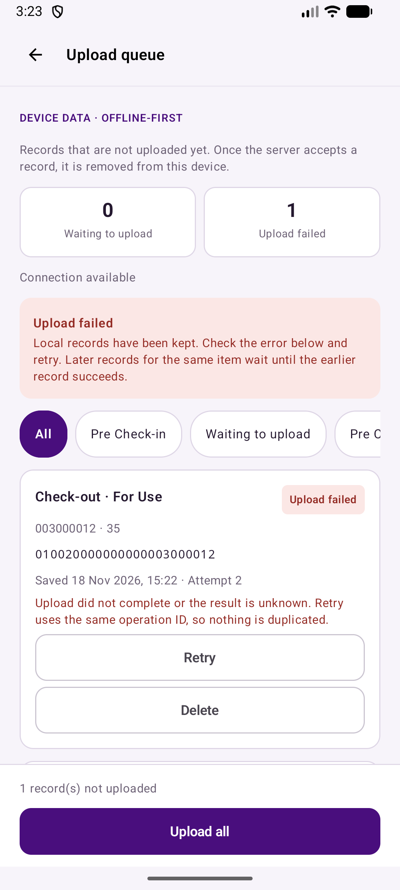

## Summary
Checking out an expired chemical on the handheld: the server refuses it (400 'Some items cannot be processed. Nothing was saved.'), but the app says 'Check-out failed ... kept in the Upload queue for retry'; the queue shows 'Upload did not complete or the result is unknown' and Retry says 'retry when the connection is stable'. The reason (expired) is never shown and a retry can never succeed.

## Steps to reproduce
1. Handheld (ADMIN): Check-out, enter 003000012 (Formaldehyde 37%, expired 31/10/2026), Find item
2. Type For Use, remarks, Add to list, verify, Review check-out, Confirm check-out
3. Open Upload queue, tap Retry

## Expected
The app says the item is expired and cannot be checked out (as the web does: 'These items are expired and cannot be checked out: ...') and does not keep it for retry.

## Actual
'Check-out failed - None of the 1 item(s) were accepted. They are kept in the Upload queue for retry.'; queue: 'Upload did not complete or the result is unknown'; Retry: '1 record(s) failed to upload ... retry when the connection is stable.' Server: item stays IN; Audit 'Rejected (400): Some items cannot be processed. Nothing was saved.' (16:22:10 and 16:23:09).

## Evidence
- Screenshot: 

## Environment
- Base URL: app: Check-out
- Env: staging

## History
- 2026-11-18: filed from explorations/2026-11-18-handheld.md in the Test Manager app.
- 2026-11-19: still reproduces after the 19/11 deploy (003000010 For Use, run 2026-11-19_1415_staging_manual).
