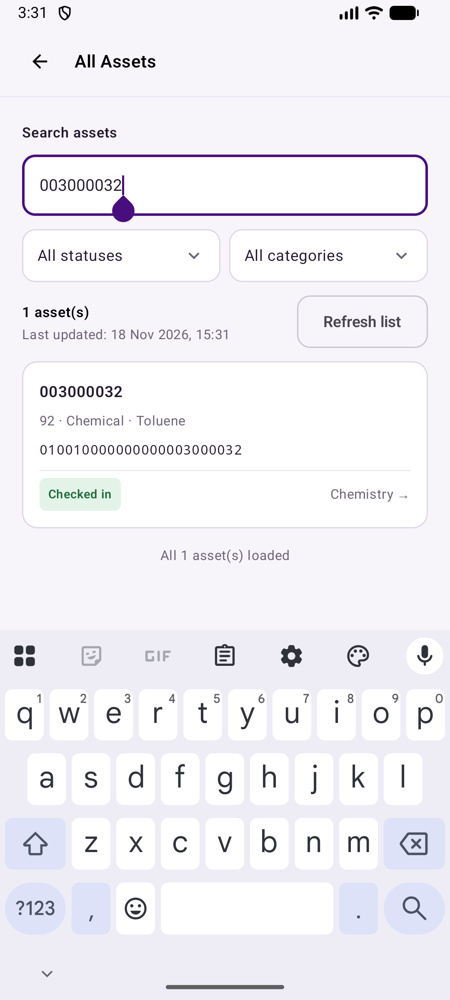

## Summary
On the handheld All Assets list a disposed item is shown as 'Checked in' at its old room. The status filter has no Disposed / Not found option.

## Steps to reproduce
1. Dispose an item through the web Stock-take adjustment (e.g. 003000032)
2. Handheld: All Assets, Refresh list, search 003000032

## Expected
The item shows as Disposed (or is not listed as available).

## Actual
'003000032 · 92 · Chemical · Toluene · Checked in · Chemistry' after Refresh list; status filter options: All statuses, Not pre check-in, Not check-in, Checked in, In use, Checked out. Web and API: DISPOSED.

## Evidence
- Screenshot: 

## Environment
- Base URL: app: All Assets
- Env: staging

## History
- 2026-11-18: filed from explorations/2026-11-18-handheld.md in the Test Manager app.
