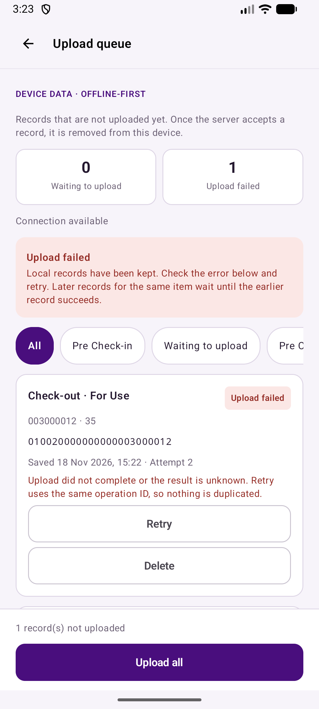

# Exploration 2026-11-18: handheld critical flows

- **Charter:** Run the handheld side of the HTX LIMS workflow on the emulator (no RFID reader: tags typed, QA simulation buttons): pre check-in, check-in, check-out, loan return, stock take, offline upload, All Assets, User role.
- **Env:** staging (UAT), app com.htx.lims.dev 0.1.0, AVD Medium_Phone; accounts ADMIN and USER1. Web checks in htx-lims-web.
- **Tester:** Aside. Runs: `runs/2026-11-18_1516_staging_manual` (HLM-003..005, 3 pass), `runs/2026-11-18_1535_staging_manual` (HLM-006..010, 3 pass, 2 fail).

## Results

| Case | Result |
|---|---|
| HLM-003 Pre check-in by tag ID | pass (4 items; review also does the Count step) |
| HLM-004 Check-in with a location per item | pass |
| HLM-005 Stock take scan and upload | pass (ST00000015) |
| HLM-006 Loan check-out | pass; no message for missing due date/remarks (BUG-006) |
| HLM-007 Expired chemical | fail: refusal shown as a connection failure, kept for retry (BUG-001) |
| HLM-008 Offline queue | pass; "Connection available" while offline (BUG-004); QA fail switch does nothing for check-out (BUG-005) |
| HLM-009 All Assets | fail: DISPOSED shown as Checked in (BUG-002); Asset shown as Fixed asset (BUG-003) |
| HLM-010 User role sign-in | pass (USER1 sees Stocktake too) |

## Findings

| # | Type | Finding | Link |
|---|---|---|---|
| 1 | bug (major) | Refused check-out (expired) reported as connection failure, kept for retry | BUG-001 |
| 2 | bug (major) | All Assets shows a DISPOSED item as Checked in | BUG-002 |
| 3 | bug (minor) | All Assets shows Asset items as Fixed asset | BUG-003 |
| 4 | bug (minor) | Upload queue says Connection available while offline | BUG-004 |
| 5 | bug (trivial) | QA: make next upload fail does not fail a check-out | BUG-005 |
| 6 | bug (minor) | Check-out Add to list: no message for missing required fields | BUG-006 |
| 7 | bug (trivial, web) | Audit "2 tag(s)" for one handheld tag | htx-lims-web BUG-009 |
| 8 | info | Handheld check-in clears the whitelist, fills Returned On and is audited (web Check In does not: htx-lims-web BUG-001, 002, 004) | |
| 9 | info | A returned loan shows "Returned" in the Loan Out Report right after pre check-in, before check-in | |

## QA data left behind

002000017 OUT on loan (loan 28, due 25/11/2026); 001000031 IN Airlock 1 (loans 27 and 29 returned); 003000025 OUT For use; 003000032 DISPOSED; ST00000015 Completed. The handheld is signed in as ADMIN with an empty Upload queue; network back on.

## Automation of the critical flows

HLM-011 (receive: web register + print -> handheld pre check-in -> check-in) and HLM-012 (handheld loan out -> return) automated in `tests/e2e/flows/item-lifecycle.spec.ts`; first green runs `runs/2026-11-18_1552_staging_playwright` (9.5 min) and `runs/2026-11-18_1602_staging_playwright` (13.7 min). Fixes on the way: the hidden "Loading..." in web grids, Zebra Browser Print blocked by Chromium's local network access checks, "Items downloaded" dialog title, scrollIntoViewIfNeeded swiping past visible elements.

QA data from the automated runs: new Consumable/Glove items "QA hlm <n>" IN in Airlock 1 (002000019 registered only, from a failed first try); the HLM-012 item is loaned and returned (IN, off the whitelist).

## Manual round 2026-11-19 (no automation)

Run `runs/2026-11-19_0920_staging_manual`: HLM-013..019, 7 pass.

- Check-out For Use (not whitelisted, "Stays in the lab · In use") and No Return (whitelisted); stock down for both (HLM-013).
- Wrong input: unknown / IN tags "Tag not found in the downloaded items"; repeated tag "Tag already scanned"; Delete tag (HLM-014). Check-in only finds pre checked-in items (HLM-015).
- Stocktake auto scan: Located / Unlocated / Extra; extras are not uploaded (HLM-016, ST00000017 aborted after). With a 1-item stock take the auto-scan simulation reports the item's own tag as Extra (simulation only, ST00000016 aborted).
- Settings without a reader: clear error; reader test works in simulation (HLM-017). All Assets status filters (HLM-018). Logout warns "1 record in the Upload queue has not been uploaded" (HLM-019).
- Web: Create Stock Take offers items it then refuses for the same period (htx-lims-web BUG-010).
- Data: 002000022 OUT For Use, 002000024 OUT No Return, 002000023 back IN (finishes the cut-off HLM-012 run); ST00000016/17 aborted. Emulators: Aside uses Medium_Phone (emulator-5554), the user Medium_Tablet (emulator-5556).
