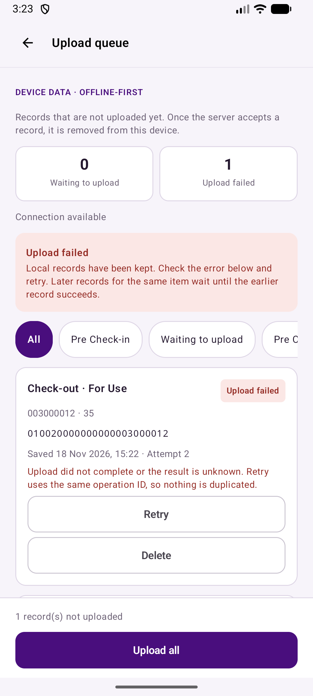
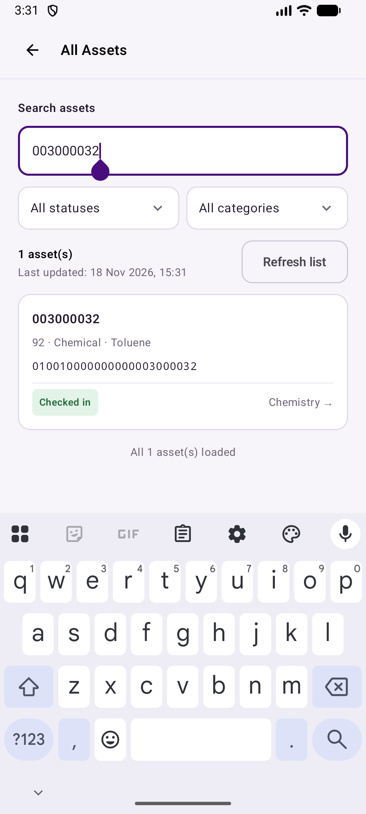

# Run report: htx-lims-mobile / handheld-flows-2-2026-11-18 / staging

| Field | Value |
|---|---|
| Result | **FAIL (2 failed)** |
| Run | 2026-11-18_1535_staging_manual |
| Runner | manual |
| Base URL | https://htx.eastus.cloudapp.azure.com:5001/ |
| Started | 2026-11-18 15:35 |
| Duration | 1.0s |

## Summary

| Total | Pass | Fail | Flaky | Blocked | Skipped |
|---:|---:|---:|---:|---:|---:|
| 5 | 3 | 2 | 0 | 0 | 0 |

## Results

| ID | Title | Status | Checks | Time | Notes | Evidence |
|---|---|---|---|---|---|---|
| HLM-006 | Check out an item on loan on the handheld | pass | - | 0.0s | - | - |
| HLM-007 | The handheld refuses to check out an expired chemical and says why | fail | - | 0.0s | product-bug; BUG-001 | [1](screenshots/HLM-007-m01-hlm-expired-queue.png) |
| HLM-008 | Records made offline wait in the Upload queue and upload when the connection is back | pass | - | 0.0s | - | - |
| HLM-009 | All Assets shows each item's status, category and room | fail | - | 0.0s | product-bug; BUG-002 | [1](screenshots/HLM-009-m01-hlm-allassets-disposed.png) |
| HLM-010 | A User-role account signs in on the handheld | pass | - | 0.0s | - | [1](screenshots/HLM-010-m01-hlm-user1-stocktake.png) |

## Failures and warnings

### HLM-007: The handheld refuses to check out an expired chemical and says why (fail)

- Failure type: product-bug (bug BUG-001)
- Source: `projects/htx-lims-mobile/cases/check-out/HLM-007-the-handheld-refuses-to-check-out-an.md`
- Note: 003000012 (expired) For Use: "Check-out failed ... kept in the Upload queue for retry"; queue "Upload did not complete or the result is unknown"; Retry "retry when the connection is stable". Server refused (400), item stays IN.

### HLM-009: All Assets shows each item's status, category and room (fail)

- Failure type: product-bug (bug BUG-002)
- Source: `projects/htx-lims-mobile/cases/assets/HLM-009-all-assets-shows-each-item-s-status.md`
- Note: 003000032 (DISPOSED) shown as "Checked in · Chemistry" after Refresh list; Asset items (001000029, 001000031) shown as "Fixed asset" (BUG-003).

