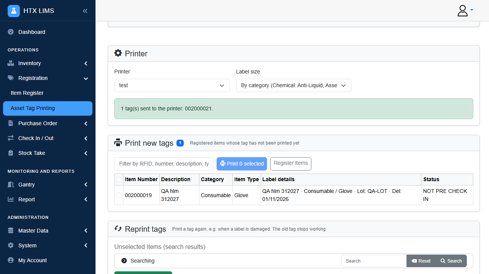

# Run report: htx-lims-mobile / playwright / staging

| Field | Value |
|---|---|
| Result | **FAIL (1 failed)** |
| Run | 2026-11-18_1546_staging_playwright |
| Runner | playwright |
| Base URL | https://htx.eastus.cloudapp.azure.com:5001/ |
| Started | 2026-11-18 15:46 |
| Duration | 2m 36s |

## Summary

| Total | Pass | Fail | Flaky | Blocked | Skipped |
|---:|---:|---:|---:|---:|---:|
| 1 | 0 | 1 | 0 | 0 | 0 |

## Results

| ID | Title | Status | Checks | Time | Notes | Evidence |
|---|---|---|---|---|---|---|
| HLM-011 | a new item is received on the handheld: pre check-in and check-in | fail | 19/20 | 2m 32s | untriaged | [1](screenshots/HLM-011-a1-1.png) [2](traces/HLM-011-a1-3.zip) |

## Failures and warnings

### HLM-011: a new item is received on the handheld: pre check-in and check-in (fail)

- Failure type: untriaged
- Source: `projects/htx-lims-mobile/tests/e2e/flows/item-lifecycle.spec.ts`
- Failed: Step: 2. Handheld: pre check-in by chip code (actual: `LocatorError: Locator timed out waiting for state "visible" after 15000ms`)
- Error: LocatorError: Locator timed out waiting for state "visible" after 15000ms

## Notes

Playwright project "htx-lims-mobile". Full Playwright HTML report: reports/playwright-html/index.html, open with npm run report (overwritten by the next run).
