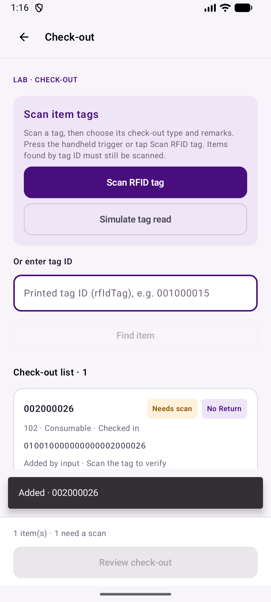

# Run report: htx-lims-mobile / manual / staging

| Field | Value |
|---|---|
| Result | **FAIL (1 failed)** |
| Run | 2026-11-19_1332_staging_manual |
| Runner | manual |
| Base URL | https://htx.eastus.cloudapp.azure.com:5001/ |
| Started | 2026-11-19 13:32 |
| Duration | 1.3s |

## Summary

| Total | Pass | Fail | Flaky | Blocked | Skipped |
|---:|---:|---:|---:|---:|---:|
| 5 | 4 | 1 | 0 | 0 | 0 |

## Results

| ID | Title | Status | Checks | Time | Notes | Evidence |
|---|---|---|---|---|---|---|
| HLM-002 | Sign in with the .env account downloads the device data and opens the Dashboard | pass | - | 0.0s | - | [1](screenshots/HLM-002-m01-hlm-002.png) |
| HLM-003 | Pre check-in a printed item by tag ID on the handheld | pass | - | 0.0s | - | [1](screenshots/HLM-003-m01-hlm-003.png) |
| HLM-004 | Check in pre checked-in items on the handheld with a location per item | pass | - | 0.0s | - | [1](screenshots/HLM-004-m01-hlm-004.png) |
| HLM-010 | A User-role account signs in on the handheld | pass | - | 0.0s | - | [1](screenshots/HLM-010-m01-hlm-010.png) |
| HLM-020 | The handheld shows the item type name for an item of a newly added type | fail | - | 0.0s | product-bug; BUG-007 | [1](screenshots/HLM-020-m01-hlm-020.png) |

## Failures and warnings

### HLM-020: The handheld shows the item type name for an item of a newly added type (fail)

- Failure type: product-bug (bug BUG-007)
- Source: `projects/htx-lims-mobile/cases/check-out/HLM-020-the-handheld-shows-the-item-type-name.md`
- Note: Check-out of 002000026 showed "102 · Consumable · Checked in" instead of the type name.

## Notes

Not a mobile test pass: handheld steps done while testing htx-lims-web on 19/11 (after the deploy), emulator Medium_Phone, recorded for traceability. HLM-013 only partly (No Return, not For Use): not recorded.
