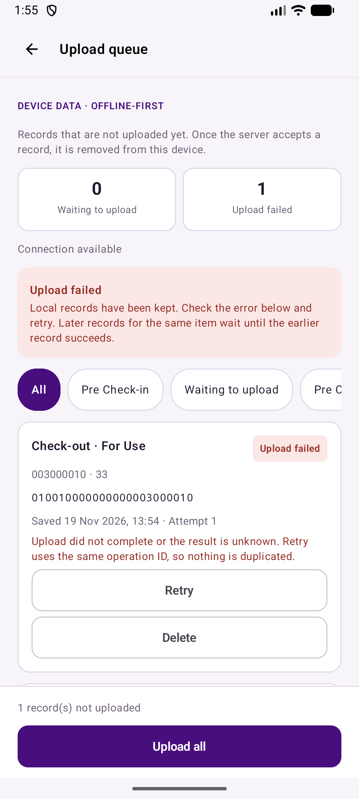
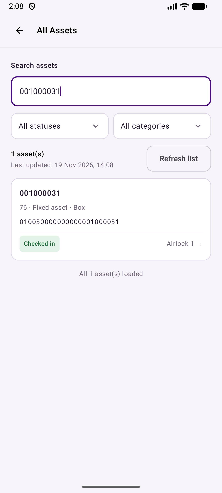
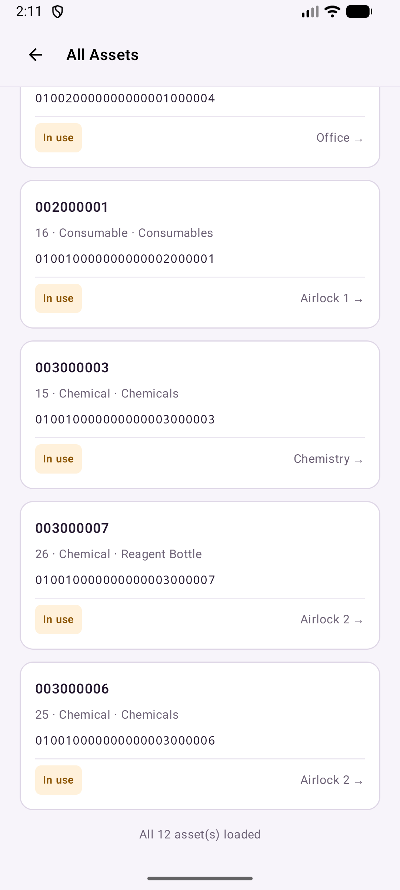
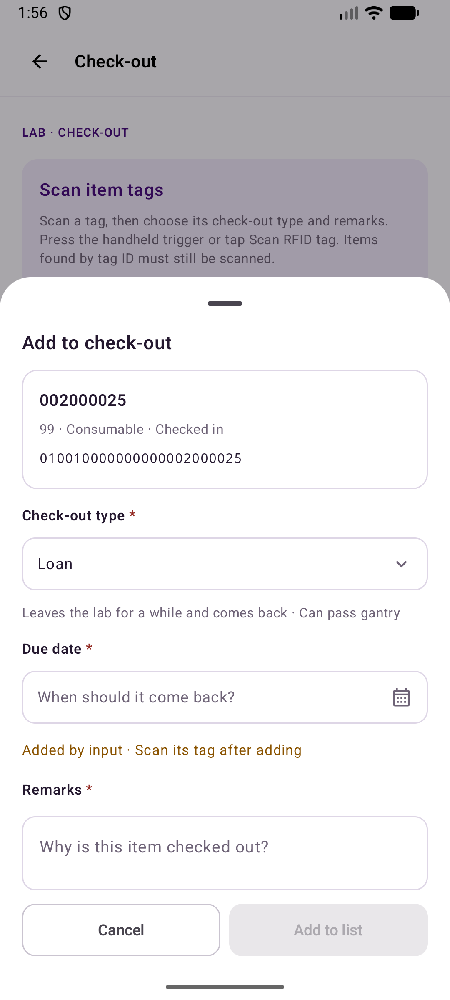

# Run report: htx-lims-mobile / manual / staging

| Field | Value |
|---|---|
| Result | **FAIL (4 failed)** |
| Run | 2026-11-19_1415_staging_manual |
| Runner | manual |
| Base URL | https://htx.eastus.cloudapp.azure.com:5001/ |
| Started | 2026-11-19 14:15 |
| Duration | 6.5s |

## Summary

| Total | Pass | Fail | Flaky | Blocked | Skipped |
|---:|---:|---:|---:|---:|---:|
| 16 | 12 | 4 | 0 | 0 | 0 |

## Results

| ID | Title | Status | Checks | Time | Notes | Evidence |
|---|---|---|---|---|---|---|
| HLM-001 | App opens on the Dashboard with every task tile | pass | - | 0.0s | - | [1](screenshots/HLM-001-m01-hlm-001-h1.png) |
| HLM-005 | Scan a stock take on the handheld and upload the results | pass | - | 0.0s | - | [1](screenshots/HLM-005-m01-hlm-005-h56.png) [2](screenshots/HLM-005-m02-hlm-005-h63.png) [3](screenshots/HLM-005-m03-hlm-005-h64.png) |
| HLM-006 | Check out an item on loan on the handheld | pass | - | 0.0s | - | [1](screenshots/HLM-006-m01-hlm-006-h47.png) [2](screenshots/HLM-006-m02-hlm-006-h49.png) |
| HLM-007 | The handheld refuses to check out an expired chemical and says why | fail | - | 0.0s | product-bug; BUG-001 | [1](screenshots/HLM-007-m01-hlm-007-h42.png) [2](screenshots/HLM-007-m02-hlm-007-h44.png) |
| HLM-008 | Records made offline wait in the Upload queue and upload when the connection is back | pass | - | 0.0s | - | [1](screenshots/HLM-008-m01-hlm-008-h15.png) [2](screenshots/HLM-008-m02-hlm-008-h16.png) [3](screenshots/HLM-008-m03-hlm-008-h19.png) |
| HLM-009 | All Assets shows each item's status, category and room | fail | - | 0.0s | product-bug; BUG-002 | [1](screenshots/HLM-009-m01-hlm-009-h65.png) [2](screenshots/HLM-009-m02-hlm-009-h66.png) [3](screenshots/HLM-009-m03-hlm-009-h67.png) |
| HLM-011 | A new item is received on the handheld: pre check-in and check-in | pass | - | 0.0s | - | [1](screenshots/HLM-011-m01-hlm-011-h12.png) [2](screenshots/HLM-011-m02-hlm-011-h31.png) |
| HLM-012 | An item is loaned out and returned on the handheld | pass | - | 0.0s | - | [1](screenshots/HLM-012-m01-hlm-012-h50.png) [2](screenshots/HLM-012-m02-hlm-012-h53.png) |
| HLM-013 | Check out For Use and No Return on the handheld | pass | - | 0.0s | - | [1](screenshots/HLM-013-m01-hlm-013-h32.png) [2](screenshots/HLM-013-m02-hlm-013-h37.png) [3](screenshots/HLM-013-m03-hlm-013-h39.png) |
| HLM-014 | Pre Check-in refuses unknown, already checked-in and repeated tags | pass | - | 0.0s | - | [1](screenshots/HLM-014-m01-hlm-014-h3.png) [2](screenshots/HLM-014-m02-hlm-014-h7.png) [3](screenshots/HLM-014-m03-hlm-014-h8.png) |
| HLM-015 | Check-in offers only items that are pre checked-in | pass | - | 0.0s | - | [1](screenshots/HLM-015-m01-hlm-015-h20.png) [2](screenshots/HLM-015-m02-hlm-015-h23.png) |
| HLM-016 | Stocktake scan shows located, unlocated and extra tags and uploads only stocktake items | pass | - | 0.0s | - | [1](screenshots/HLM-016-m01-hlm-016-h58.png) [2](screenshots/HLM-016-m02-hlm-016-h59.png) |
| HLM-017 | RFID reader settings without a reader and the reader test | pass | - | 0.0s | - | [1](screenshots/HLM-017-m01-hlm-017-h76.png) [2](screenshots/HLM-017-m02-hlm-017-h78.png) [3](screenshots/HLM-017-m03-hlm-017-h82.png) |
| HLM-018 | All Assets filters by status | fail | - | 0.0s | product-bug; BUG-008 | [1](screenshots/HLM-018-m01-hlm-018-h69.png) [2](screenshots/HLM-018-m02-hlm-018-h70.png) [3](screenshots/HLM-018-m03-hlm-018-h73.png) |
| HLM-019 | Logout warns about records that are not uploaded | pass | - | 0.0s | - | [1](screenshots/HLM-019-m01-hlm-019-h17.png) |
| HLM-020 | The handheld shows the item type name for an item of a newly added type | fail | - | 0.0s | product-bug; BUG-007 | [1](screenshots/HLM-020-m01-hlm-020-h32.png) [2](screenshots/HLM-020-m02-hlm-020-h46.png) |

## Failures and warnings

### HLM-007: The handheld refuses to check out an expired chemical and says why (fail)

- Failure type: product-bug (bug BUG-001)
- Source: `projects/htx-lims-mobile/cases/check-out/HLM-007-the-handheld-refuses-to-check-out-an.md`
- Note: Expired chemical 003000010 (expired 18/11) For Use: "Check-out failed - None of the 1 item(s) were accepted. They are kept in the Upload queue for retry."; queue says "Upload did not complete or the result is unknown" with no reason; record deleted by hand. Item stays IN. Same as before the deploy.

### HLM-009: All Assets shows each item's status, category and room (fail)

- Failure type: product-bug (bug BUG-002)
- Source: `projects/htx-lims-mobile/cases/assets/HLM-009-all-assets-shows-each-item-s-status.md`
- Note: All Assets after refresh (97 assets): IN, OUT (Checked out) and For Use (In use) items match the web, with type and room. Still wrong: DISPOSED 003000032 shown as "Checked in" (BUG-002) and Asset 001000031 shown as "Fixed asset" (BUG-003).

### HLM-018: All Assets filters by status (fail)

- Failure type: product-bug (bug BUG-008)
- Source: `projects/htx-lims-mobile/cases/assets/HLM-018-all-assets-filters-by-status.md`
- Note: Filters list only matching items (Checked out = Loan / No Return, In use = For Use, Not check-in = 0, matching the web), but the count shows only the items loaded so far: "7 asset(s)" for In use until scrolling shows "All 12 asset(s) loaded" (server: 12 For Use); Checked out "13 asset(s)" vs 19 on the server.

### HLM-020: The handheld shows the item type name for an item of a newly added type (fail)

- Failure type: product-bug (bug BUG-007)
- Source: `projects/htx-lims-mobile/cases/check-out/HLM-020-the-handheld-shows-the-item-type-name.md`
- Note: Not only new types: every Check-out card shows a number instead of the type name (002000025 "99", 002000027 "103", 002000028 "104", 003000010 "33"), the item's internal id; All Assets shows "<id> · Category · Type".

## Notes

Post-deploy pass of the remaining handheld cases on emulator Medium_Phone (dev build 0.1.0) against UAT, 19/11/2026. Web used for setup and checks. QA data: 002000027 OUT For Use, 002000028 OUT No Return, 002000029 printed only, 002000025 IN (loaned and returned), ST00000020 aborted.
