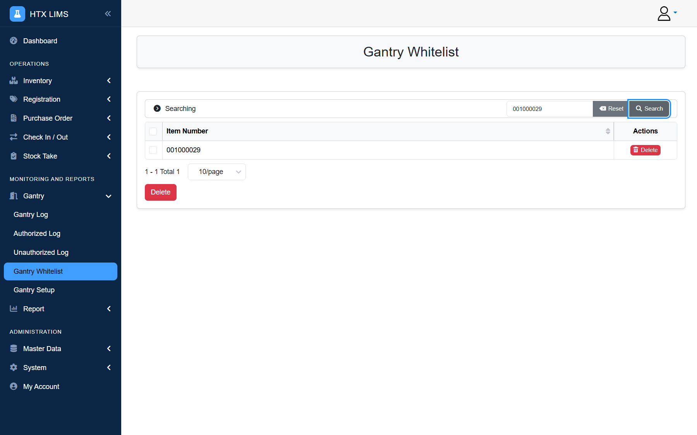

## Summary
After a Loan item is checked in on the web (Check In / Out > Check In), its status becomes IN but it stays on the gantry whitelist and keeps purpose LOAN, so it can be carried out through an exit gantry without an Unauthorized removal alert.

## Steps to reproduce
1. Log in as a User or Administrator
2. Check Out > tick an IN item (e.g. 001000029), Purpose Loan, Due Date 25/11/2026, Check Out > OK
3. Gantry > Gantry Whitelist: the item is listed (correct)
4. Check In / Out > Check In > search the item > Check In
5. Gantry > Gantry Whitelist > search the item; or GET /api/Gantry (the list the gantries download)

## Expected
After check-in the item is IN and no longer on the gantry whitelist (workflow: 'After the check-in the status is IN again, the item leaves the whitelist').

## Actual
Status IN, exhibitStatus still LOAN, and the item is still on the whitelist (GantryWhitelist id 111 for 001000029) one minute and later. Reproduced with 001000029 (User1 loan 23) and 001000027 (Admin loan 24).

## Evidence
- Screenshot: 
- API after check-in: GET /api/Item/68 status=IN exhibitStatus=LOAN; GET /api/Gantry contains 010030000000000001000029

## Environment
- Base URL: https://htx.eastus.cloudapp.azure.com:5001/checkin
- Env: staging

## History
- 2026-11-18: filed from explorations/2026-11-18-web-testing.md in the Test Manager app.
