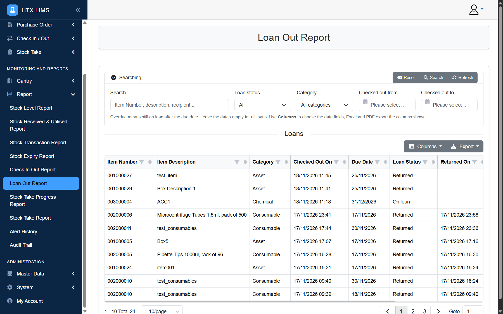

## Summary
After a loaned item is checked in, the Loan Out Report shows Loan Status Returned but the Returned On column is empty.

## Steps to reproduce
1. Check out an item on Loan
2. Check it in on Check In / Out > Check In
3. Report > Loan Out Report

## Expected
Returned On shows the check-in date and time.

## Actual
'001000029 Box Description 1 Asset 18/11/2026 11:41 25/11/2026 Returned (empty) User1 QA loan 288991'; same for 001000027.

## Evidence
- Screenshot: 

## Environment
- Base URL: https://htx.eastus.cloudapp.azure.com:5001/loanoutreport
- Env: staging

## History
- 2026-11-18: filed from explorations/2026-11-18-web-testing.md in the Test Manager app.
- 2026-11-18: Web-only: a loan returned through the handheld (pre check-in + check-in) shows Returned On (001000031: Returned 18/11/2026 16:09)..
