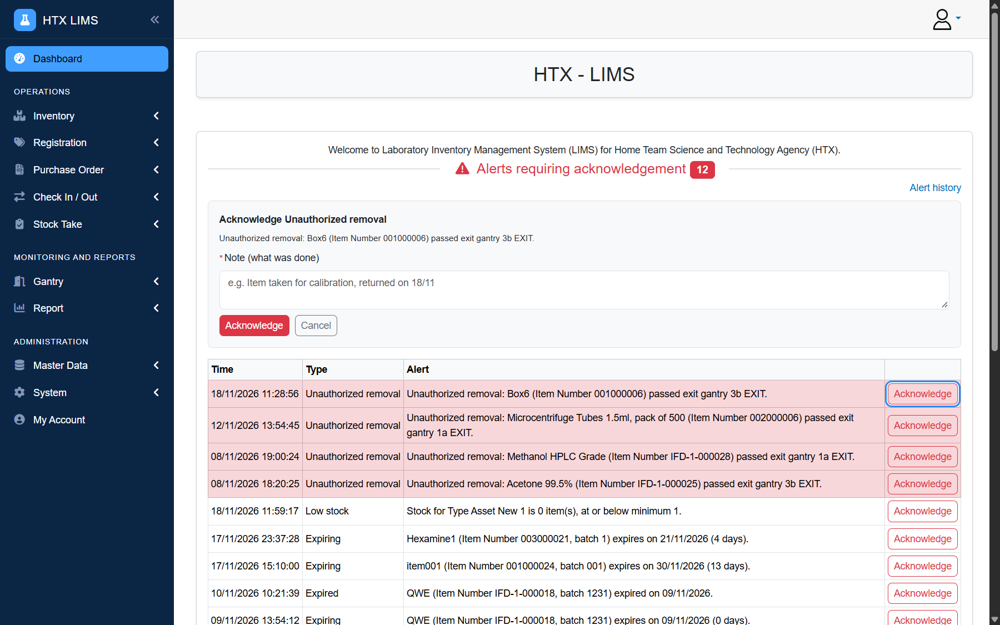

## Summary
Clicking Acknowledge on an alert in 'Alerts requiring acknowledgement' has no effect: no dialog, no message, the alert stays and is not acknowledged on the server. Alerts were acknowledged on 17/11/2026, so this looks like a regression.

## Steps to reproduce
1. Log in as ADMIN
2. Dashboard > Alerts requiring acknowledgement
3. Click Acknowledge on 'Unauthorized removal: Box6 (Item Number 001000006) passed exit gantry 3b EXIT.'
4. Reload the Dashboard; open Report > Alert History

## Expected
The alert leaves the list, the count drops by 1 and Alert History shows it Acknowledged with user and time.

## Actual
Nothing happens; count stays 12; GET /api/inventory/alerts?includeAcknowledged=true shows id 15 with acknowledgedOn empty; Alert History status Open. Tried 3 times (full page load and menu navigation); no browser console error.

## Evidence
- Screenshot: 
- Last acknowledgements in the data: 17/11/2026 08:30 by ADMIN

## Environment
- Base URL: https://htx.eastus.cloudapp.azure.com:5001/dashboard
- Env: staging

## History
- 2026-11-18: filed from explorations/2026-11-18-web-testing.md in the Test Manager app.
