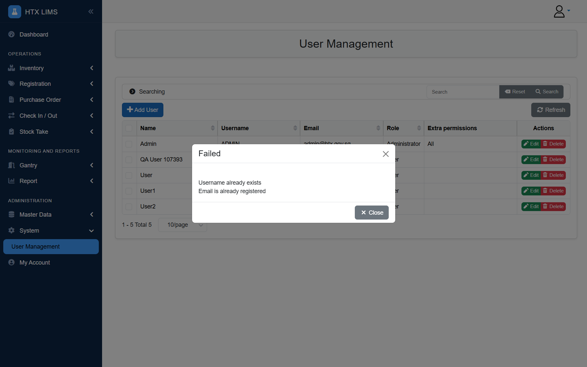

## Summary
In System > User Management > Add User the Role field already shows 'User', but Save does nothing (no message, no user) until Role is opened and User is picked again.

## Steps to reproduce
1. Log in as ADMIN
2. System > User Management > Add User
3. Fill Name, Username, Email, Password and Confirm password (valid), leave Role as shown ('User')
4. Click Save

## Expected
The user is created with Role User, or a message says what is missing.

## Actual
No message, the dialog stays open and no user is added (3 tries). After picking Role > User in the dropdown, Save creates the user (QAUSER107393), and the dialog still stays open.

## Evidence
- Screenshot: 

## Environment
- Base URL: https://htx.eastus.cloudapp.azure.com:5001/usermanagement
- Env: staging

## History
- 2026-11-18: filed from explorations/2026-11-18-web-testing.md in the Test Manager app.
