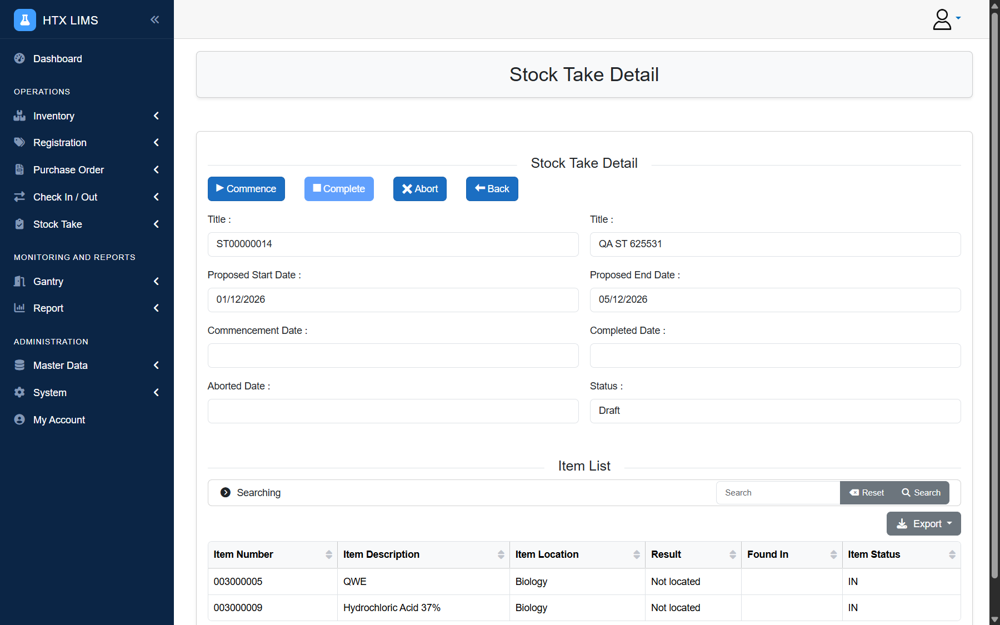

## Summary
After Move to Selected, the items are listed under Selected Items but Submit says 'At least have 1 selected items to submit' until their checkboxes in Selected Items are ticked again. Submitting with nothing selected at all shows no message.

## Steps to reproduce
1. Log in as ADMIN
2. Stock Take > Create Stock Take, Storage Location Biology, Search
3. Tick both items, Move to Selected
4. Enter Title and dates, Submit

## Expected
The items under Selected Items are the stock take's items; Submit creates the stock take.

## Actual
'Failed At least have 1 selected items to submit.' Ticking the items again in Selected Items makes Submit work (ST00000014).

## Evidence
- Screenshot: 

## Environment
- Base URL: https://htx.eastus.cloudapp.azure.com:5001/stocktake
- Env: staging

## History
- 2026-11-18: filed from explorations/2026-11-18-web-testing.md in the Test Manager app.
