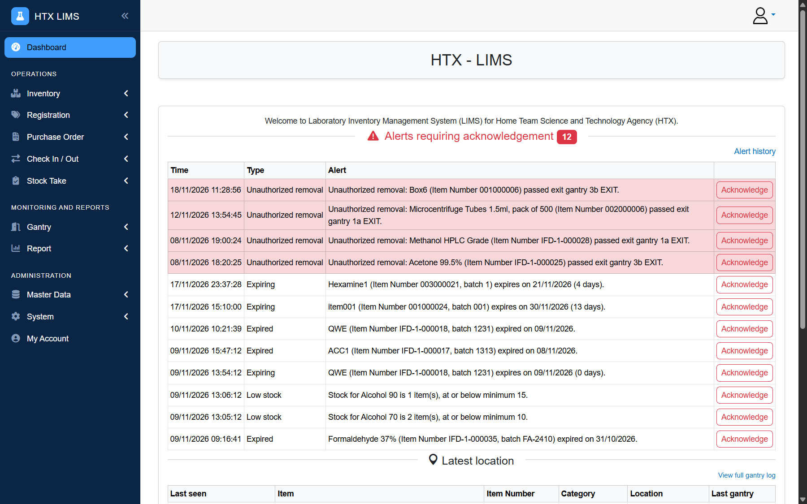

# Exploration 2026-11-18: gantry flow through the HTX API

- **Charter:** Test the gantry flow (authorized exit, unauthorized removal, location tracking) through the HTX API Swagger, and align the cases with the user's workflow document (HTX LIMS Workflow.html).
- **Env:** staging (UAT). Swagger account `HLW_SWAGGER_*` (gantry flow only, user's go-ahead in chat); API calls as ADMIN.
- **Tester:** Aside.

## Coverage

- Read the API (swagger.json): gantry, whitelist, item and alert endpoints; findings in [context/gantry.md](../context/gantry.md).
- Data check: all 69 items, their status and purpose against the whitelist the gantries download.
- Four gantry reads through `POST /api/Gantry/authorizerfid` / `unauthorizerfid`, then the web Dashboard, Unauthorized Log and Gantry Log.

| Test | Item | Gantry | Result |
|---|---|---|---|
| Whitelisted Loan item exits | 001000003 (OUT, Loan) | 1a EXIT, authorized | Authorized Log, Airlock 1, no alert: pass (HLW-022) |
| IN item exits unauthorized | 001000006 (IN) | 3b EXIT, unauthorized | Unauthorized Log, Airlock 2, status IN, Dashboard alert at 11:28:56: pass (HLW-021) |
| IN item through an inner gantry | 001000009 (IN) | 2a, authorized | Location Chemistry, status IN, no alert: pass (HLW-031) |
| Non-whitelisted IN item reported authorized at an exit | 001000009 (IN) | 1a EXIT, authorized | Logged Authorized, no alert: the server trusts the gantry (Q-003) |

## Findings

| # | Type | Finding | Link |
|---|---|---|---|
| 1 | question | 6 Loan / No return items checked out on 8-9 Nov are not on the gantry whitelist | [Q-002](../questions/Q-002-should-loan-no-return-items-checked-out.md) |
| 2 | question | The server does not check the whitelist for gantry reads; the gantry endpoints need no login | [Q-003](../questions/Q-003-should-the-server-check-the-whitelist.md) |
| 3 | question | No Stock Adjustment page in the menu although the workflow and permissions mention it | [Q-004](../questions/Q-004-where-is-stock-adjustment-dispose-an.md) |

## Cases

Rewritten for the API: HLW-021, HLW-022. New from the workflow: HLW-031..046 (gantry location, gantry 1a before check-in, whitelist by purpose, loan return, item number format, CAS required, delete before printing, label by category, reprint, FEFO expired / order, all-or-nothing check-out, loan due date, stock by purpose, expiry alerts, low/high stock). Updated: HLW-013..016. Executed: HLW-021, HLW-022, HLW-031 (pass).

## QA data left behind

- Unacknowledged alert: "Unauthorized removal: Box6 (Item Number 001000006) passed exit gantry 3b EXIT." (18/11/2026 11:28:56).
- Gantry log entries 18/11/2026 11:28-11:30 for 001000003, 001000006, 001000009 (officer Admin). Box6 and Box9 were moved back to Airlock 1 (gantry 1b); Box3 (on loan) is now in Airlock 1.
