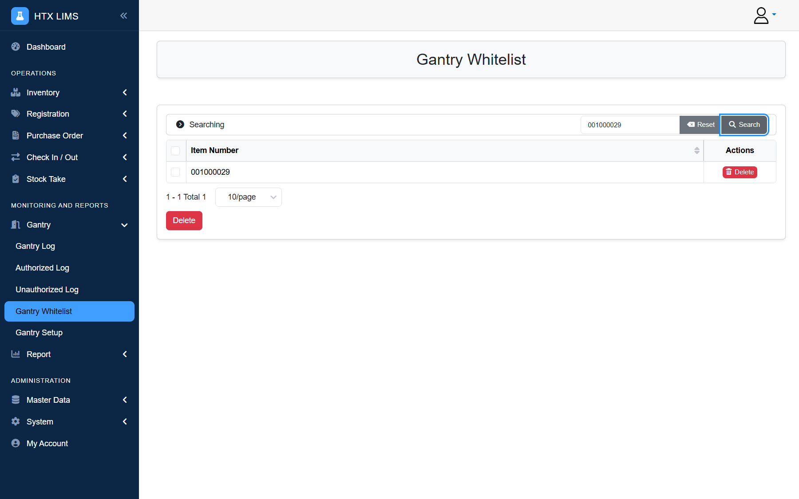

# Testing 2026-11-18: HTX LIMS web, first pass

- **Charter:** Run the HTX LIMS web cases by hand: read-only cases plus writes that can be undone (created data deleted, loans checked back in). Irreversible scenarios were held back for the user's approval.
- **Env:** staging (UAT). Accounts ADMIN, USER1, USER2 (one wrong-password attempt). Another tester was active at the same time (stock takes ST00000012/13, other IPs in the Audit Trail).
- **Tester:** Aside. Manual run: `runs/2026-11-18_1057_staging_manual` (28 cases: 25 pass, 3 fail).

## Results

| Area | Cases | Result |
|---|---|---|
| Login, logout, roles | HLW-002..006 | pass |
| PO | HLW-007, 008 | pass (a new PO is APPROVED at once) |
| Item Register | HLW-010, 011, 012, 035, 036, 037 | pass (Delete has no confirmation: BUG-003) |
| Check out / in | HLW-015, 017, 040, 042, 043 pass; HLW-014 fail | returned loan stays whitelisted (BUG-001), Returned On empty (BUG-004) |
| Gantry whitelist | HLW-033 fail | BUG-001 |
| Reports | HLW-019, 023, 025, 026 pass; HLW-027 fail | web check-in missing from the Audit Trail (BUG-002) |
| Alerts | HLW-045, 046 pass | old alerts use old item numbers (Q-005) |
| Master data | HLW-029 pass | |

Not run: HLW-024 (no chemical with several batches of different expiry dates), HLW-044 (only the Loan part was seen: stock unchanged), HLW-009, 013, 016, 018, 020, 028, 030, 038, 039, 041 (irreversible or real printer: waiting for approval), HLW-032, 034 (need the handheld), HLW-001 (automated).

## Findings

| # | Type | Finding | Link |
|---|---|---|---|
| 1 | bug (critical) | Web Check In leaves a returned loan item on the gantry whitelist with purpose LOAN | [BUG-001](../bugs/) |
| 2 | bug (major) | Web Manual Check-In is not in the Audit Trail | BUG-002 |
| 3 | bug (minor) | Item Register Delete has no confirmation | BUG-003 |
| 4 | bug (minor) | Loan Out Report: Returned On empty for returned loans | BUG-004 |
| 5 | question | Old alerts show old-format item numbers; a stale Expired alert stays after the expiry date changed | Q-005 |
| 6 | question | Web Check In of OUT items: one click, no location, no pre check-in | Q-006 |
| 7 | info | Stock adjustment exists: stock take results set items NOT FOUND ("Stock adjustment ... Status: IN → NOT FOUND" in the Audit Trail) | Q-004 |

## QA data left behind

- 001000029 (Box Description 1, Chemistry) and 001000027 (test_item, Airlock 2): loaned and checked in again; now IN but still on the gantry whitelist with purpose LOAN (BUG-001). Loans 23 and 24 show Returned. Left as they are for the developers; remove them from Gantry Whitelist once BUG-001 is looked at.
- Deleted again: items 003000025, 002000017..019; PO QA-PO-3781642; item type "QA type 126550".
- Audit Trail entries of the above, one failed USER2 login (11:34:52).
