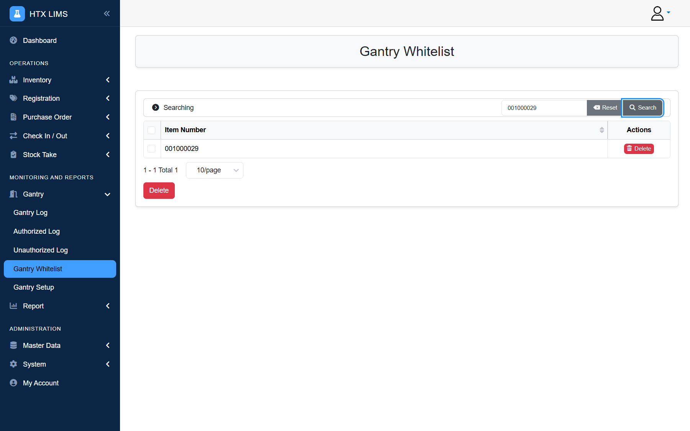
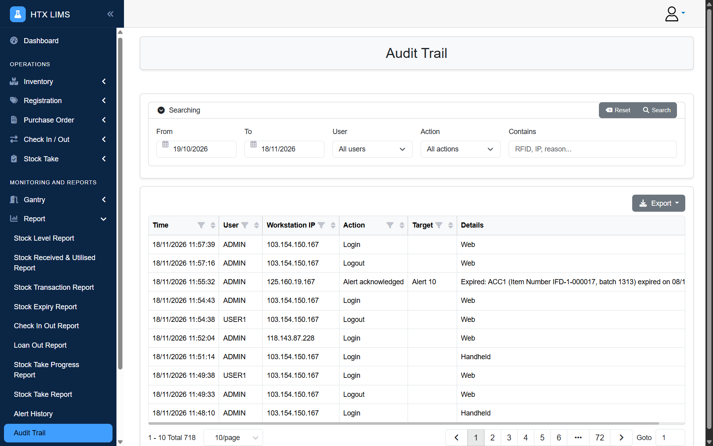

# Run report: htx-lims-web / web-testing-2026-11-18 / staging

| Field | Value |
|---|---|
| Result | **FAIL (3 failed)** |
| Run | 2026-11-18_1057_staging_manual |
| Runner | manual |
| Base URL | https://htx.eastus.cloudapp.azure.com:5001/ |
| Started | 2026-11-18 10:57 |
| Duration | 4.0s |

## Summary

| Total | Pass | Fail | Flaky | Blocked | Skipped |
|---:|---:|---:|---:|---:|---:|
| 28 | 25 | 3 | 0 | 0 | 0 |

## Results

| ID | Title | Status | Checks | Time | Notes | Evidence |
|---|---|---|---|---|---|---|
| HLW-002 | Administrator logs in and lands on the Dashboard | pass | - | 0.0s | - | - |
| HLW-003 | Login with a wrong password is refused | pass | - | 0.0s | - | - |
| HLW-004 | Log out ends the session | pass | - | 0.0s | - | - |
| HLW-005 | User role sees only the operations menu | pass | - | 0.0s | - | - |
| HLW-006 | User role cannot open administrator pages by address | pass | - | 0.0s | - | - |
| HLW-007 | Create a purchase order | pass | - | 0.0s | - | - |
| HLW-008 | PO Creation requires a PO date | pass | - | 0.0s | - | - |
| HLW-010 | Register a new item | pass | - | 0.0s | - | - |
| HLW-011 | Register several units at once | pass | - | 0.0s | - | - |
| HLW-012 | Item Register checks required fields | pass | - | 0.0s | - | - |
| HLW-014 | Check in an item that is out | fail | - | 0.0s | product-bug; BUG-001 | [1](screenshots/HLW-014-m01-bug-whitelist.png) |
| HLW-015 | Check out an item on loan with a due date | pass | - | 0.0s | - | - |
| HLW-017 | Check Out needs a selected item and a due date for loans | pass | - | 0.0s | - | - |
| HLW-019 | Stock take progress and results are reported | pass | - | 0.0s | - | - |
| HLW-023 | Find an item in Item Information | pass | - | 0.0s | - | - |
| HLW-025 | Stock Level Report flags low stock | pass | - | 0.0s | - | - |
| HLW-026 | Stock Expiry Report lists items expiring within a number of days | pass | - | 0.0s | - | - |
| HLW-027 | Audit Trail records user actions | fail | - | 0.0s | product-bug; BUG-002 | [1](screenshots/HLW-027-m01-audit-trail.png) |
| HLW-029 | Add an item type to a category | pass | - | 0.0s | - | - |
| HLW-033 | The gantry whitelist follows the check-out purpose | fail | - | 0.0s | product-bug; BUG-001 | [1](screenshots/HLW-033-m01-bug-whitelist.png) |
| HLW-035 | A new item gets a 9-digit item number from its category | pass | - | 0.0s | - | - |
| HLW-036 | A chemical cannot be registered without a CAS number | pass | - | 0.0s | - | - |
| HLW-037 | A registered item can be deleted only until its tag is printed | pass | - | 0.0s | - | - |
| HLW-040 | Checking out an expired chemical is refused | pass | - | 0.0s | - | - |
| HLW-042 | If one item of a check-out fails, nothing is saved | pass | - | 0.0s | - | - |
| HLW-043 | A loan due date in the past is refused | pass | - | 0.0s | - | - |
| HLW-045 | Expiring and expired items raise Dashboard alerts | pass | - | 0.0s | - | - |
| HLW-046 | Stock at or below minimum raises a Low stock alert | pass | - | 0.0s | - | - |

## Failures and warnings

### HLW-014: Check in an item that is out (fail)

- Failure type: product-bug (bug BUG-001)
- Source: `projects/htx-lims-web/cases/check-in-out/HLW-014-check-in-an-item-that-is-out.md`
- Note: ADMIN Check In of 001000029 (OUT, Loan): "Successfully Manual Check-In Selected Item" (no confirmation, no location asked), status IN; but the item stays on the gantry whitelist and keeps purpose LOAN (BUG-001); Loan Out Report Returned with empty Returned On (BUG-004). Repro with 001000027.

### HLW-027: Audit Trail records user actions (fail)

- Failure type: product-bug (bug BUG-002)
- Source: `projects/htx-lims-web/cases/reports/HLW-027-audit-trail-records-user-actions.md`
- Note: Audit Trail logs logins (web/handheld), failed login, item registered/number assigned/deleted, check-out (no workstation IP), stock adjustment; the two web Manual Check-Ins of 18/11 11:43 and 11:46 (001000029, 001000027) are missing.

### HLW-033: The gantry whitelist follows the check-out purpose (fail)

- Failure type: product-bug (bug BUG-001)
- Source: `projects/htx-lims-web/cases/gantry/HLW-033-the-gantry-whitelist-follows-the-check.md`
- Note: Loan check-out added 001000029 to the whitelist (pass); check-in did not remove it (BUG-001). No return / For use part not run.

