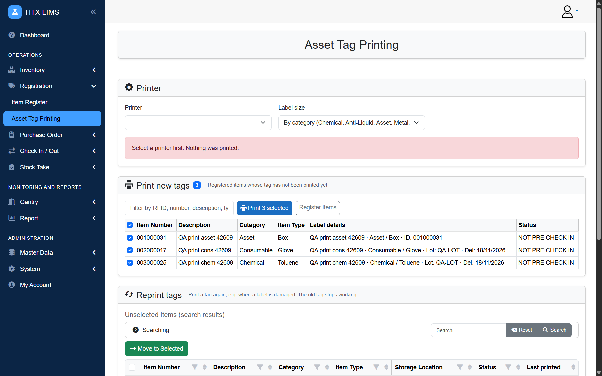
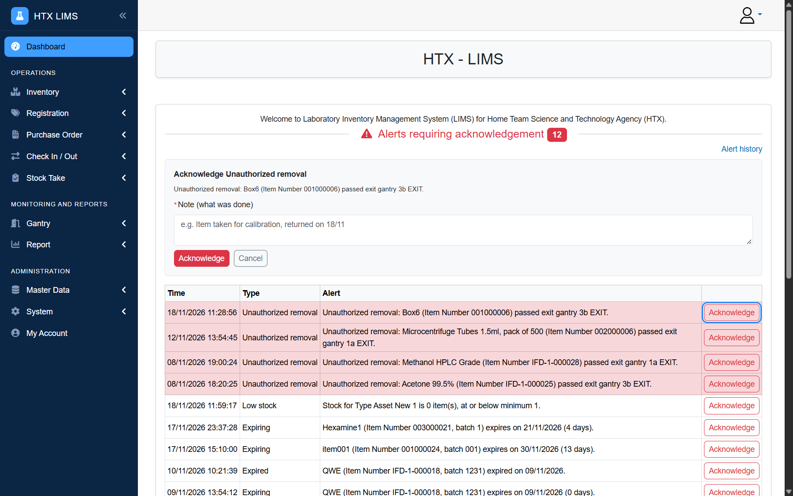
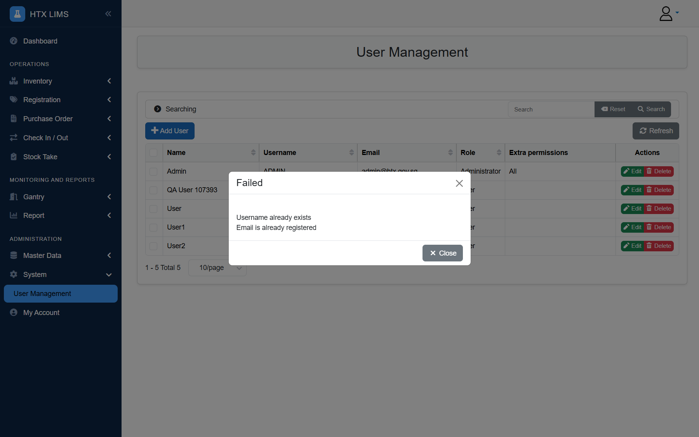

# Run report: htx-lims-web / web-testing-approved-2026-11-18 / staging

| Field | Value |
|---|---|
| Result | **FAIL (2 failed)** |
| Run | 2026-11-18_1115_staging_manual |
| Runner | manual |
| Base URL | https://htx.eastus.cloudapp.azure.com:5001/ |
| Started | 2026-11-18 11:15 |
| Duration | 2.0s |

## Summary

| Total | Pass | Fail | Flaky | Blocked | Skipped |
|---:|---:|---:|---:|---:|---:|
| 10 | 4 | 2 | 0 | 4 | 0 |

## Results

| ID | Title | Status | Checks | Time | Notes | Evidence |
|---|---|---|---|---|---|---|
| HLW-009 | Approve a purchase order | blocked | - | 0.0s | No PO waits for approval: QAPO521908 (USER1) is APPROVED as soon as it is created. Approve on it asks "Are you sure want to approve PO QAPO521908?" then "Failed PO is already approved". Waiting on Q-001. | - |
| HLW-013 | Print RFID tags for a newly registered item | blocked | - | 0.0s | Asset Tag Printing has no printer to choose (Printer list empty); Print 3 selected (001000031, 002000017, 003000025, label size By category) -> "Select a printer first. Nothing was printed." Needs a Zebra printer configured for UAT. | [1](screenshots/HLW-013-m01-hlw-013.png) |
| HLW-016 | Check out for use and with no return | pass | - | 0.0s | - | - |
| HLW-018 | Create a stock take for a storage location | pass | - | 0.0s | - | - |
| HLW-020 | Acknowledge an alert on the Dashboard | fail | - | 0.0s | product-bug; BUG-005 | [1](screenshots/HLW-020-m01-hlw-020.png) |
| HLW-028 | Add a storage location | pass | - | 0.0s | - | - |
| HLW-030 | Add a user with the User role | fail | - | 0.0s | product-bug; BUG-006 | [1](screenshots/HLW-030-m01-hlw-030.png) |
| HLW-038 | Label size By category picks the tag type of the item's category | blocked | - | 0.0s | Asset Tag Printing has no printer to choose (Printer list empty); Print 3 selected (001000031, 002000017, 003000025, label size By category) -> "Select a printer first. Nothing was printed." Needs a Zebra printer configured for UAT. | [1](screenshots/HLW-038-m01-hlw-013.png) |
| HLW-039 | Reprinting a tag issues a new chip code and retires the old tag | blocked | - | 0.0s | Asset Tag Printing has no printer to choose (Printer list empty); Print 3 selected (001000031, 002000017, 003000025, label size By category) -> "Select a printer first. Nothing was printed." Needs a Zebra printer configured for UAT. | [1](screenshots/HLW-039-m01-hlw-013.png) |
| HLW-044 | Stock follows the check-out purpose | pass | - | 0.0s | - | - |

## Failures and warnings

### HLW-009: Approve a purchase order (blocked)

- Source: `projects/htx-lims-web/cases/purchase-order/HLW-009-approve-a-purchase-order.md`
- Note: No PO waits for approval: QAPO521908 (USER1) is APPROVED as soon as it is created. Approve on it asks "Are you sure want to approve PO QAPO521908?" then "Failed PO is already approved". Waiting on Q-001.

### HLW-013: Print RFID tags for a newly registered item (blocked)

- Source: `projects/htx-lims-web/cases/tag-printing/HLW-013-print-rfid-tags-for-a-newly-registered.md`
- Note: Asset Tag Printing has no printer to choose (Printer list empty); Print 3 selected (001000031, 002000017, 003000025, label size By category) -> "Select a printer first. Nothing was printed." Needs a Zebra printer configured for UAT.

### HLW-020: Acknowledge an alert on the Dashboard (fail)

- Failure type: product-bug (bug BUG-005)
- Source: `projects/htx-lims-web/cases/alerts/HLW-020-acknowledge-an-alert-on-the-dashboard.md`
- Note: ADMIN, Dashboard: Acknowledge on "Unauthorized removal: Box6 (Item Number 001000006) passed exit gantry 3b EXIT." does nothing (3 tries, full load and menu navigation): no dialog, no console error, count stays 12; API acknowledgedOn stays empty; Alert History status Open.

### HLW-030: Add a user with the User role (fail)

- Failure type: product-bug (bug BUG-006)
- Source: `projects/htx-lims-web/cases/users/HLW-030-add-a-user-with-the-user-role.md`
- Note: Add User with all fields valid and Role showing "User": Save does nothing (no message, no user; 3 tries). Only after picking Role > User again in its dropdown does Save create the user (QAUSER107393, Role User); the dialog stays open after saving. The new user logs in with Role: User and the User-role menu.

### HLW-038: Label size By category picks the tag type of the item's category (blocked)

- Source: `projects/htx-lims-web/cases/tag-printing/HLW-038-label-size-by-category-picks-the-tag.md`
- Note: Asset Tag Printing has no printer to choose (Printer list empty); Print 3 selected (001000031, 002000017, 003000025, label size By category) -> "Select a printer first. Nothing was printed." Needs a Zebra printer configured for UAT.

### HLW-039: Reprinting a tag issues a new chip code and retires the old tag (blocked)

- Source: `projects/htx-lims-web/cases/tag-printing/HLW-039-reprinting-a-tag-issues-a-new-chip-code.md`
- Note: Asset Tag Printing has no printer to choose (Printer list empty); Print 3 selected (001000031, 002000017, 003000025, label size By category) -> "Select a printer first. Nothing was printed." Needs a Zebra printer configured for UAT.

