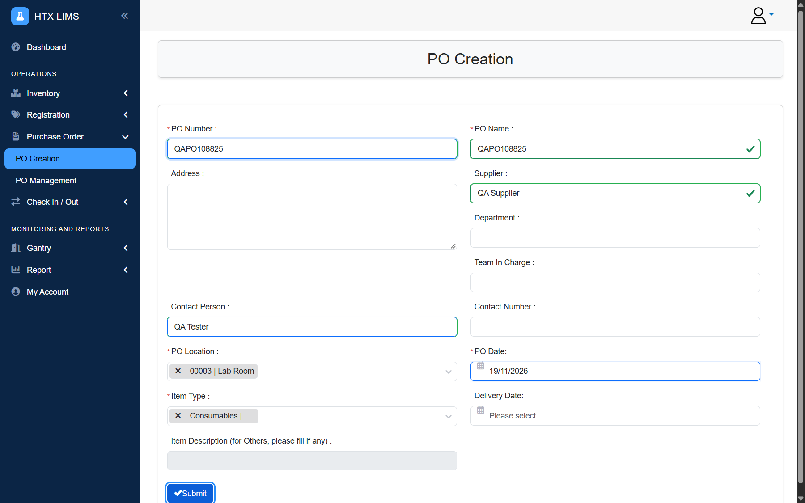
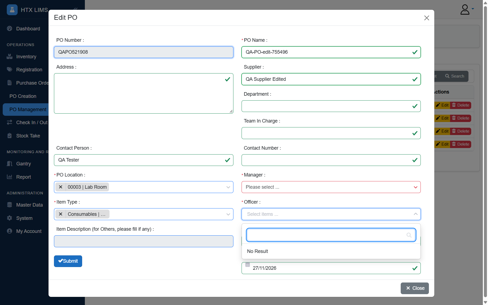
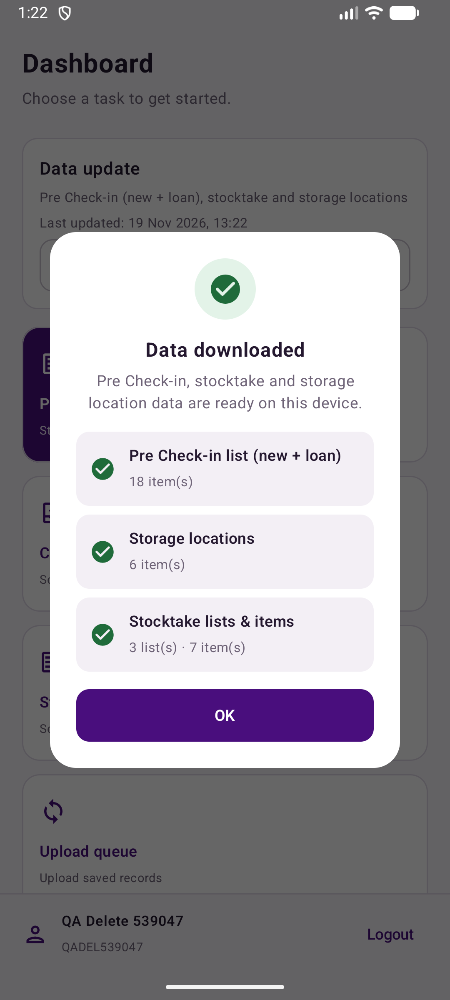
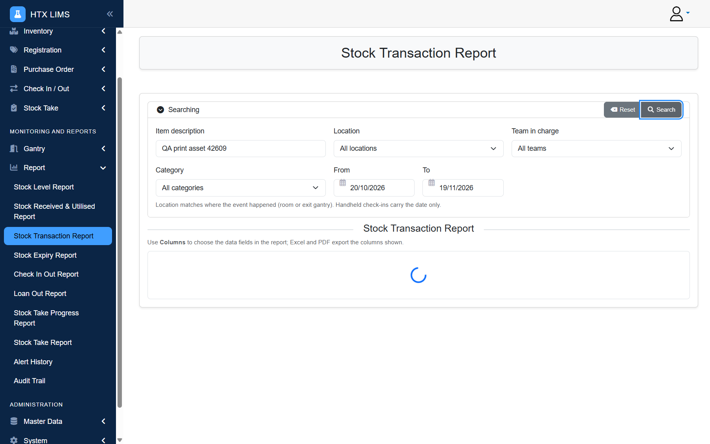
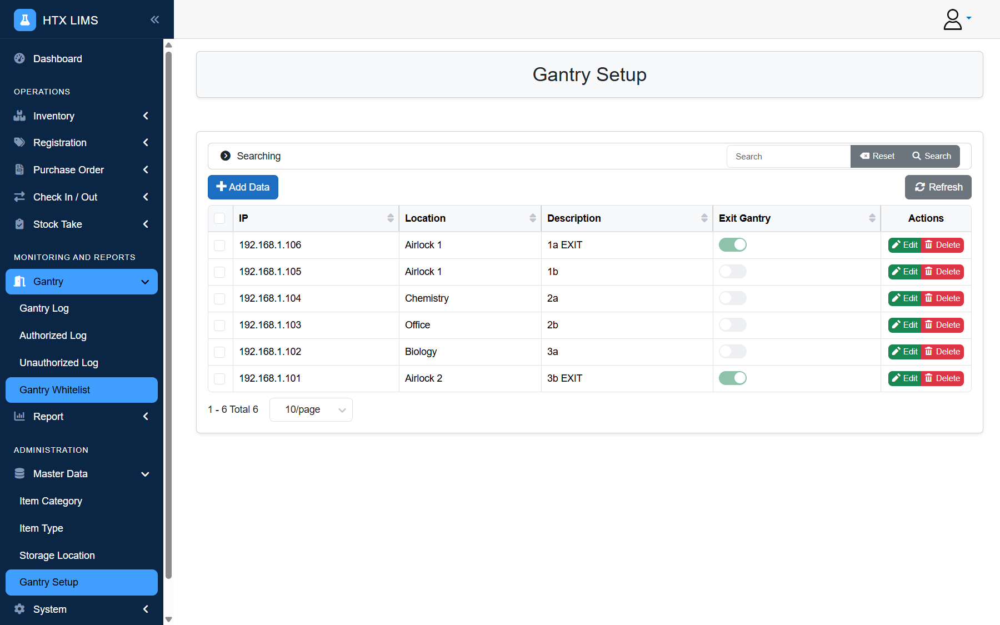
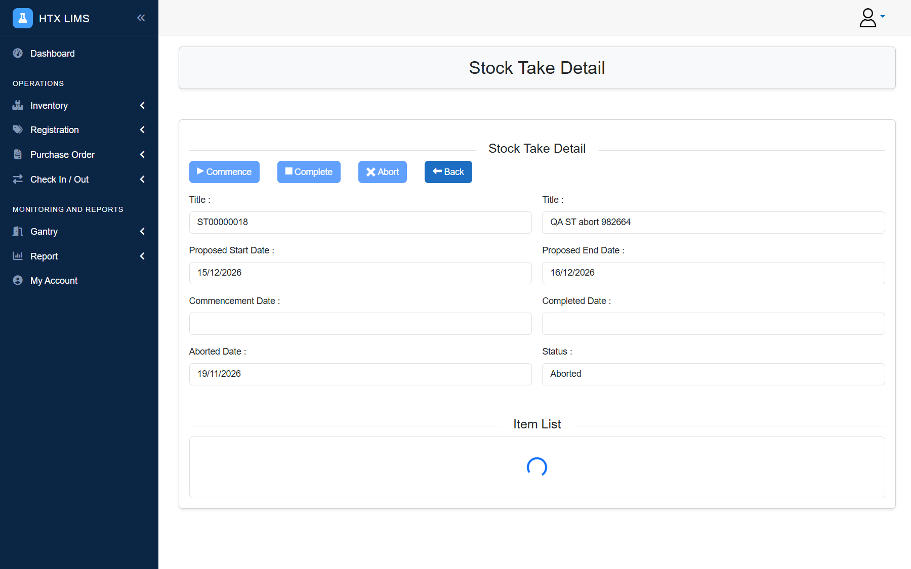
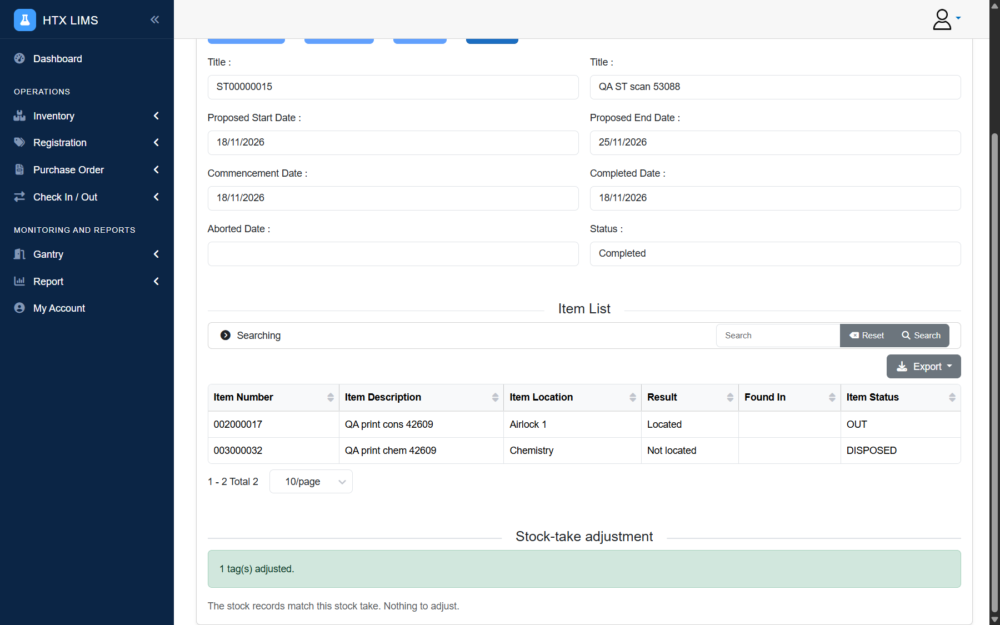

# Run report: htx-lims-web / manual / staging

| Field | Value |
|---|---|
| Result | **FAIL (9 failed)** |
| Run | 2026-11-19_1327_staging_manual |
| Runner | manual |
| Base URL | https://htx.eastus.cloudapp.azure.com:5001/ |
| Started | 2026-11-19 13:27 |
| Duration | 5.4s |

## Summary

| Total | Pass | Fail | Flaky | Blocked | Skipped |
|---:|---:|---:|---:|---:|---:|
| 19 | 9 | 9 | 0 | 1 | 0 |

## Results

| ID | Title | Status | Checks | Time | Notes | Evidence |
|---|---|---|---|---|---|---|
| HLW-005 | User role sees only the operations menu | blocked | - | 0.0s | After the 19/11 deploy the User menu has Report (10 reports, all but Audit Trail; /loanoutreport opens) and Check In / Out shows Registered Not Printed / Printed Not Pre-Checked In instead of Printed / Count Item. Stock Take, Master Data, System still hidden. Waiting on Q-011. | - |
| HLW-007 | Create a purchase order | fail | - | 0.0s | product-bug; BUG-011 | [1](screenshots/HLW-007-m01-hlw-052-po-create.png) |
| HLW-020 | Acknowledge an alert on the Dashboard | fail | - | 0.0s | product-bug; BUG-005 | - |
| HLW-050 | Edit a registered item's details | pass | - | 0.0s | - | [1](screenshots/HLW-050-m01-hlw-050-edited.png) |
| HLW-051 | Edit a purchase order | fail | - | 0.0s | product-bug; BUG-012 | [1](screenshots/HLW-051-m01-hlw-051-submit-no-manager.png) [2](screenshots/HLW-051-m02-hlw-051-officer-list.png) |
| HLW-052 | Delete a purchase order | fail | - | 0.0s | product-bug; BUG-015 | - |
| HLW-053 | A deleted user can no longer log in | fail | - | 0.0s | product-bug; BUG-014 | [1](screenshots/HLW-053-m01-hlw-053-deleted-user-still-syncs.png) |
| HLW-054 | Changing a user's role takes effect at the next login | pass | - | 0.0s | - | [1](screenshots/HLW-054-m01-hlw-054-admin.png) [2](screenshots/HLW-054-m02-hlw-054-user-blocked.png) |
| HLW-055 | The Stock adjustment extra permission lets a User adjust stock take results | pass | - | 0.0s | - | [1](screenshots/HLW-055-m01-hlw-055-no-permission.png) [2](screenshots/HLW-055-m02-hlw-055-adjusted.png) |
| HLW-056 | A loan past its due date shows as Overdue in the Loan Out Report | pass | - | 0.0s | - | [1](screenshots/HLW-056-m01-hlw-056-overdue.png) |
| HLW-057 | Stock at or above maximum raises a High stock alert | pass | - | 0.0s | - | [1](screenshots/HLW-057-m01-hlw-057-stock-level.png) |
| HLW-058 | Register a chemical with Certificate of Analysis, SDS file and photo | pass | - | 0.0s | - | - |
| HLW-059 | Stock Received & Utilised Report counts received and used items | pass | - | 0.0s | - | [1](screenshots/HLW-059-m01-hlw-059-received.png) |
| HLW-060 | Stock Transaction Report lists an item's check-out and check-in | fail | - | 0.0s | product-bug; BUG-019 | [1](screenshots/HLW-060-m01-hlw-060-transactions.png) |
| HLW-061 | Aborting a stock take leaves item statuses unchanged and frees its items | pass | - | 0.0s | - | [1](screenshots/HLW-061-m01-bug-user-aborts-stocktake.png) |
| HLW-062 | Two users checking out the same item at the same time: only one succeeds | pass | - | 0.0s | - | [1](screenshots/HLW-062-m01-hlw-062-web-refreshed.png) [2](screenshots/HLW-062-m02-hlw-062-checkinout.png) |
| HLW-064 | Gantry menu links open the matching pages | fail | - | 0.0s | product-bug; BUG-018 | [1](screenshots/HLW-064-m01-bug-gantry-whitelist-link.png) |
| HLW-065 | The User role cannot commence, complete or abort a stock take by address | fail | - | 0.0s | product-bug; BUG-013 | [1](screenshots/HLW-065-m01-bug-user-aborts-stocktake.png) |
| HLW-066 | A stock adjustment that sets a loaned item IN takes it off the gantry whitelist | fail | - | 0.0s | product-bug; BUG-016 | [1](screenshots/HLW-066-m01-hlw-055-adjusted.png) |

## Failures and warnings

### HLW-005: User role sees only the operations menu (blocked)

- Source: `projects/htx-lims-web/cases/access/HLW-005-user-role-sees-only-the-operations-menu.md`
- Note: After the 19/11 deploy the User menu has Report (10 reports, all but Audit Trail; /loanoutreport opens) and Check In / Out shows Registered Not Printed / Printed Not Pre-Checked In instead of Printed / Count Item. Stock Take, Master Data, System still hidden. Waiting on Q-011.

### HLW-007: Create a purchase order (fail)

- Failure type: product-bug (bug BUG-011)
- Source: `projects/htx-lims-web/cases/purchase-order/HLW-007-create-a-purchase-order.md`
- Note: PO Creation after the deploy: 6 Submits with all required fields (ADMIN x4, USER1 x2), only QAPODEL812171 saved, and it appeared in PO Management only after a new login; no success or error message ever. No Audit Trail entry.

### HLW-020: Acknowledge an alert on the Dashboard (fail)

- Failure type: product-bug (bug BUG-005)
- Source: `projects/htx-lims-web/cases/alerts/HLW-020-acknowledge-an-alert-on-the-dashboard.md`
- Note: Retest after the deploy with QA alert 27 (High stock, QA high 373230): Acknowledge does nothing, count stays 23, acknowledgedOn null.

### HLW-051: Edit a purchase order (fail)

- Failure type: product-bug (bug BUG-012)
- Source: `projects/htx-lims-web/cases/purchase-order/HLW-051-edit-a-purchase-order.md`
- Note: Edit PO QAPO521908 (and PO001): changed PO Name / Supplier, Submit does nothing; Manager and Officer are required but both lists show "No Result"; only a hidden tooltip "SelectedItemManager is required.". No PO can be edited.

### HLW-052: Delete a purchase order (fail)

- Failure type: product-bug (bug BUG-015)
- Source: `projects/htx-lims-web/cases/purchase-order/HLW-052-delete-a-purchase-order.md`
- Note: Delete on QAPODEL812171: confirmation "Are you sure you want to perform this operation?", Cancel keeps the PO, Ok removes it (gone after reload). No Audit Trail entry for the deletion (BUG-015). A fresh QA PO could not be created first (BUG-011), so the one saved attempt was used.

### HLW-053: A deleted user can no longer log in (fail)

- Failure type: product-bug (bug BUG-014)
- Source: `projects/htx-lims-web/cases/users/HLW-053-a-deleted-user-can-no-longer-log-in.md`
- Note: QADEL539047 (User) created, handheld signed in as it; ADMIN deleted the user (Cancel keeps it, Ok deletes). 1 min later the handheld "Update all data" still succeeded as the deleted user (BUG-014). New sign-in refused on handheld ("Username or password is incorrect") and web ("Invalid login attempt."). No Audit Trail entry for add/delete (BUG-015).

### HLW-060: Stock Transaction Report lists an item's check-out and check-in (fail)

- Failure type: product-bug (bug BUG-019)
- Source: `projects/htx-lims-web/cases/reports/HLW-060-stock-transaction-report-lists-an-item.md`
- Note: QA print asset 42609 (001000031): loans and handheld check-ins listed in time order with event and user. Location empty on check-in/out rows; handheld pre check-in shown as "Registered to PO" (BUG-019).

### HLW-064: Gantry menu links open the matching pages (fail)

- Failure type: product-bug (bug BUG-018)
- Source: `projects/htx-lims-web/cases/gantry/HLW-064-gantry-menu-links-open-the-matching.md`
- Note: Gantry > Gantry Whitelist opens /gantrysetup (Gantry Setup); /gantrywhitelist works by address.

### HLW-065: The User role cannot commence, complete or abort a stock take by address (fail)

- Failure type: product-bug (bug BUG-013)
- Source: `projects/htx-lims-web/cases/access/HLW-065-the-user-role-cannot-commence-complete.md`
- Note: USER1 (User, no extra permissions) opened /stocktakedetail/ST00000018: Commence and Abort enabled; Abort > confirm set it to Aborted.

### HLW-066: A stock adjustment that sets a loaned item IN takes it off the gantry whitelist (fail)

- Failure type: product-bug (bug BUG-016)
- Source: `projects/htx-lims-web/cases/stocktake/HLW-066-a-stock-adjustment-that-sets-a-loaned.md`
- Note: 002000017 adjusted OUT -> IN in ST00000015: Item status IN but exhibitStatus LOAN and GantryWhitelist/status true; Loan Out Report Returned with no Returned On.

## Notes

Never-run web cases HLW-050..062 plus HLW-064..066 (found today), HLW-007 / HLW-020 retests and HLW-005 after the 19/11 deploy. Web as ADMIN / USER1 / QAUSER107393 / QADEL539047, handheld on emulator Medium_Phone.
