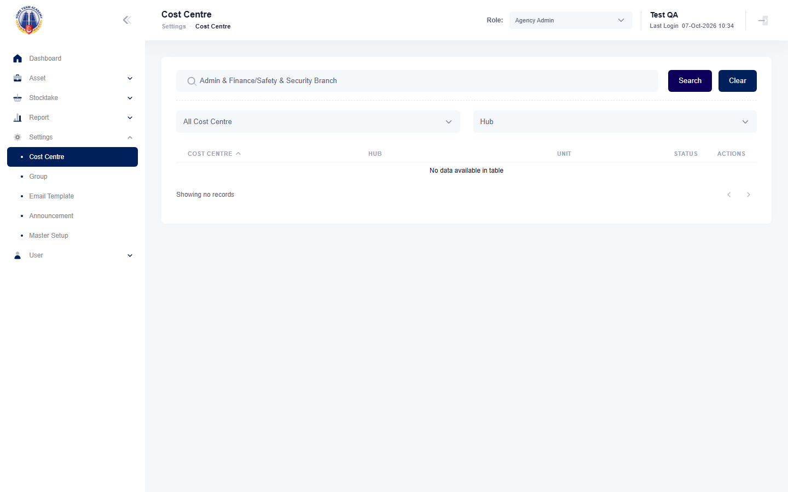

## Summary
The keyword box says "Cost Centre Code/Cost Centre Desc", but only the code and the short name match. Searching a description returns no records. Same defect as mha-spf BUG-012.

## Steps to reproduce
1. Log in as the HTA test account, role Agency Admin
2. Settings > Cost Centre, open 338000 A&F/SSB: Description "Admin & Finance/Safety & Security Branch"
3. Back on the list, type that description in the keyword box, Search

## Expected
338000 is listed (placeholder "Cost Centre Code/Cost Centre Desc").

## Actual
No records. Searching 338000 finds it.

## Evidence
- Screenshot: 

## Environment
- Base URL: https://mhauatwebhta.southeastasia.cloudapp.azure.com/Setting/CostCenter
- Env: staging

## History
- 2026-10-07: filed from the first HTA run (HTA-051 failed at step 3); same as mha-spf BUG-012.