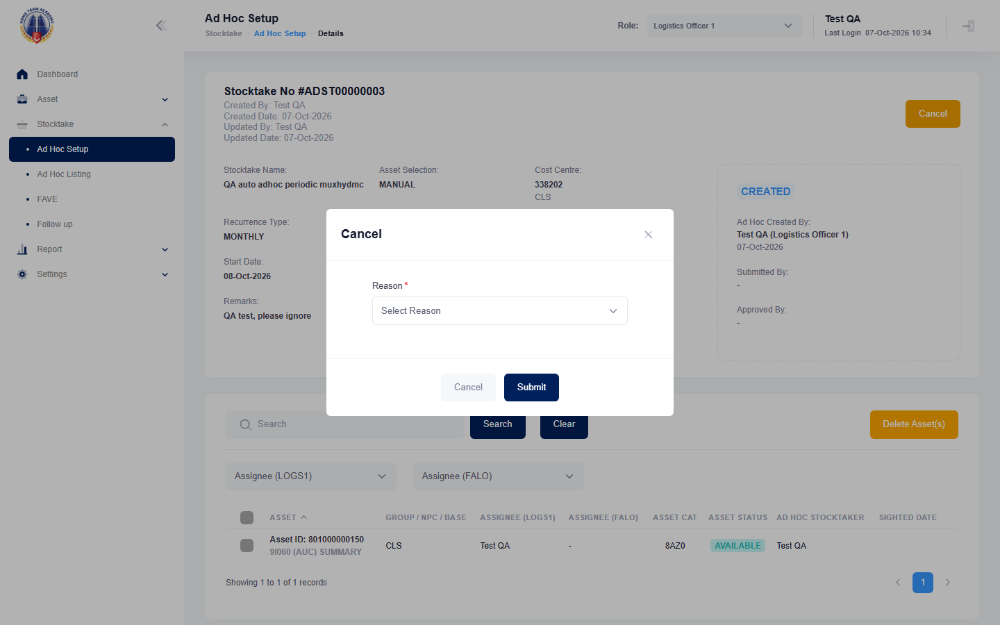

## Summary
On a CREATED ad hoc stocktake, the Cancel dialog's Reason dropdown has no readable option ("Others" is missing), so users cannot pick a reason and the stocktake cannot be cancelled. Same defect as mha-spf BUG-001 (there the only option is value OTHER with an empty label).

## Steps to reproduce
1. Log in as the HTA test account, role Logistics Officer 1
2. Stocktake > Ad Hoc Setup > Create: Periodic, Manual, any name, Recurrence MONTHLY, keep tomorrow as Start Date, Next, tick one asset, Next, Submit
3. Open the new ADST number (status CREATED) and click Cancel
4. Open the Reason dropdown

## Expected
Readable reasons, including "Others" (then Remarks), and "Stocktake Ad Hoc has been cancelled." on Submit.

## Actual
No "Others" option; the dropdown shows only "Select Reason". Seen on ADST00000003. The test cleanup cancels by selecting the hidden value OTHER, which works.

## Evidence
- Screenshot: 

## Environment
- Base URL: https://mhauatwebhta.southeastasia.cloudapp.azure.com/Stocktake/StocktakeForm?stktakeId=<id>
- Env: staging

## History
- 2026-10-07: filed from the first HTA run (HTA-023 failed at step 4); same as mha-spf BUG-001.