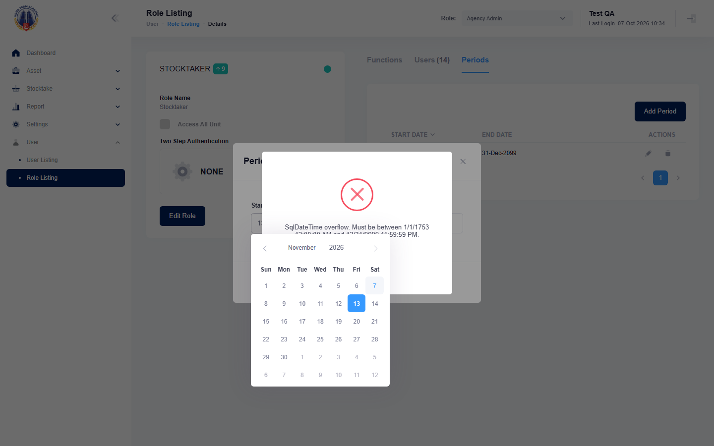

## Summary
The Add Period dialog picks dates as dd/mm/yyyy, but the server reads them as mm/dd/yyyy: any day above 12 is rejected with a raw database error, so role validity periods cannot be set correctly. Same defect as mha-spf BUG-011 (there a day up to 12 is also saved with day and month swapped).

## Steps to reproduce
1. Log in as the HTA test account, role Agency Admin
2. User > Role Listing, pencil of Stocktaker (any role), tab Periods, Add Period
3. Pick Start Date 13 Nov 2026 and End Date 20 Nov 2026 in the calendar, Submit

## Expected
"Period has been successfully saved." and a row 13-Nov-2026 to 20-Nov-2026.

## Actual
"SqlDateTime overflow. Must be between 1/1/1753 12:00:00 AM and 12/31/9999 11:59:59 PM." Nothing is saved.

## Evidence
- Screenshot: 

## Environment
- Base URL: https://mhauatwebhta.southeastasia.cloudapp.azure.com/User/Role
- Env: staging

## History
- 2026-10-07: filed from the first HTA run (HTA-048 failed at step 1-2); same as mha-spf BUG-011.