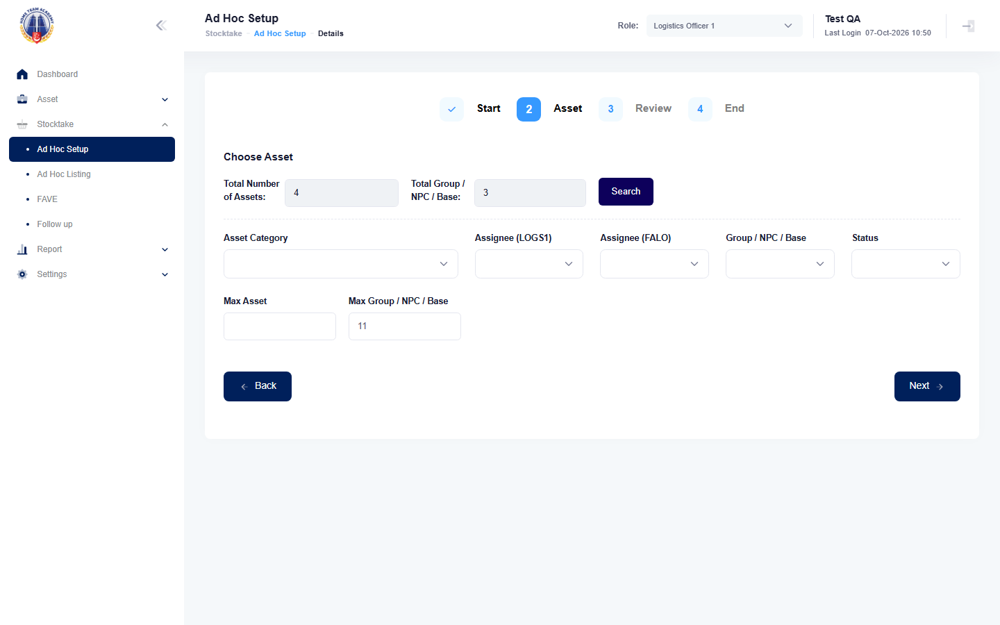

## Summary
With Asset Selection RANDOM and Max Group / NPC / Base 1, a Search drew 4 assets from 3 groups. The limit is exceeded now and then (random draw). Same defect as mha-spf BUG-016 (there an asset with no group counted as an extra group).

## Steps to reproduce
1. Log in as the HTA test account, role Logistics Officer 1
2. Stocktake > Ad Hoc Setup > Create: Periodic, Random, any name, Next
3. Choose Asset: Max Group / NPC / Base 1, Search; repeat Search a few times and read Total Group / NPC / Base

## Expected
Total Group / NPC / Base is at most 1 on every Search.

## Actual
Search 4 of 5: "4 assets from 3 groups". The first HTA run (5 searches per limit) did not hit it.

## Evidence
- Screenshot: 

## Environment
- Base URL: https://mhauatwebhta.southeastasia.cloudapp.azure.com/Stocktake/StocktakeCreate
- Env: staging

## History
- 2026-10-07: filed from HTA run 2026-10-07_0948 (HTA-054 failed at step 3); same as mha-spf BUG-016.