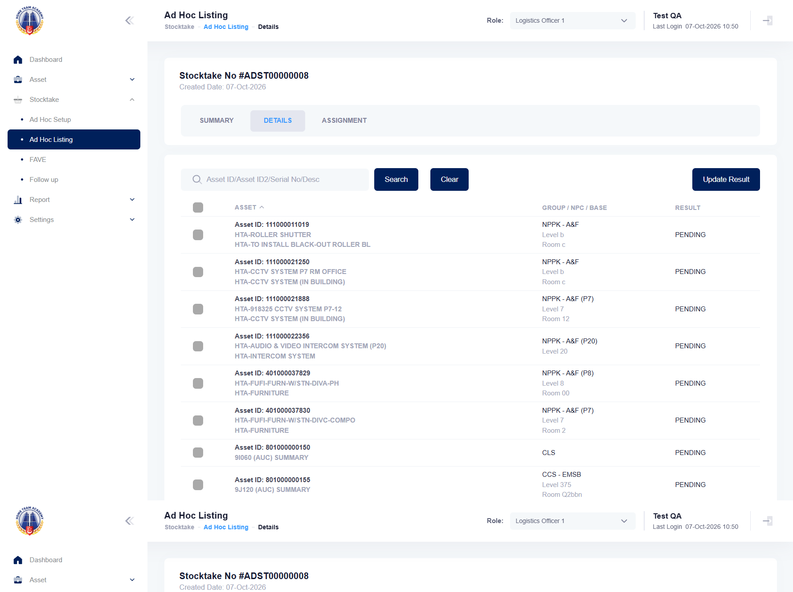

## Summary
ADST00000008 (Periodic, Random, Max Asset 3, cost centre 338202 CLS) holds 3 assets in Ad Hoc Setup (801000000150 group CLS, 801000000155 and 803000000059 group CCS - EMSB). In Ad Hoc Listing the same stocktake shows Summary "PENDING 1", while its Details tab lists 9 PENDING assets: the 3 above plus 6 "NPPK - A&F ..." assets (111000011019, 111000021250, 111000021888, 111000022356, 401000037829, 401000037830) that are not in the setup. Stocktakers would see and count the wrong assets.

## Steps to reproduce
1. Log in as the HTA test account, role Logistics Officer 1
2. Stocktake > Ad Hoc Setup > Create: Periodic, Random, any name, Recurrence MONTHLY, Next; Status AVAILABLE, Max Asset 3, Search, Next, Submit
3. Ad Hoc Setup: open the new ADST, note its 3 assets
4. Ad Hoc Listing: open the same ADST, read Summary, then Details

## Expected
Summary PENDING 3 and Details lists exactly the 3 assets of the setup.

## Actual
Summary PENDING 1; Details lists 9 assets, 6 of them not in the setup. Seen on ADST00000008. It happened when 2 of the 3 drawn assets carry a group of another cost centre (CCS - EMSB in a CLS stocktake); the first HTA run's random setup (all assets in their own cost centre's group) was listed correctly.

## Evidence
- Screenshot (Summary, from the run): 
- Screenshot (Details, checked by hand): 

## Environment
- Base URL: https://mhauatwebhta.southeastasia.cloudapp.azure.com/Stocktake/StocktakeListing
- Env: staging

## History
- 2026-10-07: filed from HTA run 2026-10-07_0948 (HTA-053 failed at step 8) and checked by hand in Aside's browser.