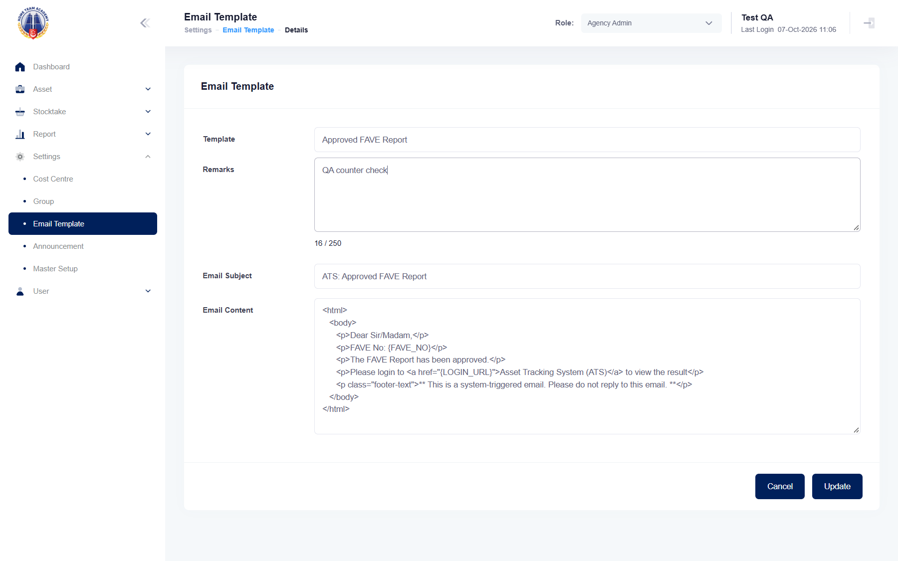

## Summary
The Remarks counter under the field reads "0 / 200" when empty but "<n> / 250" as soon as there is text; the field stops at 200 characters. Same defect as mha-spf BUG-014.

## Steps to reproduce
1. As Agency Admin, Settings > Email Template, pencil of any template
2. Type in Remarks (e.g. 16 characters)

## Expected
The counter shows "/ 200" (maxlength 200) at all times.

## Actual
"16 / 250" after typing 16 characters (checked by hand on HTA 2026-10-07).

## Evidence
- Screenshot: 

## Environment
- Base URL: https://mhauatwebhta.southeastasia.cloudapp.azure.com/Setting/EmailTemplate
- Env: staging

## History
- 2026-10-07: filed from the SPF-vs-HTA recheck; same as mha-spf BUG-014. Nothing was saved (form left without Update).
