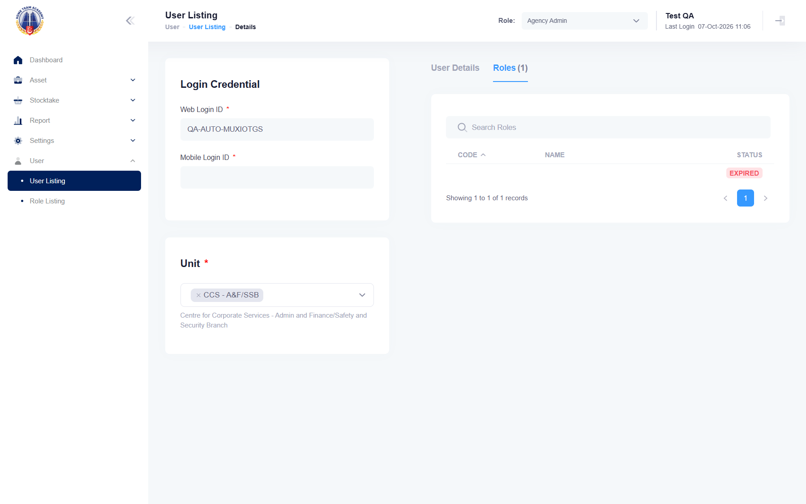

## Summary
Removing a user from a role in Role Listing keeps an EXPIRED entry that the user form lists with empty Code and Name, and the tab count still includes it. Same defect as mha-spf BUG-013.

## Steps to reproduce
1. As Agency Admin, User > User Listing > create/find a "QA auto user" and set it ACTIVE
2. User > Role Listing > Stocktaker > Users > Add User, tick the user, Submit
3. Delete the user from the role (trash icon): "Stocktaker role has been removed from User <name>."
4. User > User Listing, search the user, pencil, tab Roles

## Expected
The removed role is not listed (Roles(0)), or it is listed with its code and name (STOCKTAKER, Stocktaker) and status EXPIRED.

## Actual
Tab "Roles(1)" with one row: Code and Name empty, status EXPIRED. User Listing shows no role mapped. Reproduced on HTA 2026-10-07 (QA-AUTO-MUXIOTGS; the user was set back INACTIVE afterwards).

## Evidence
- Screenshot: 

## Environment
- Base URL: https://mhauatwebhta.southeastasia.cloudapp.azure.com/User/User
- Env: staging

## History
- 2026-10-07: filed from the SPF-vs-HTA recheck; same as mha-spf BUG-013.
