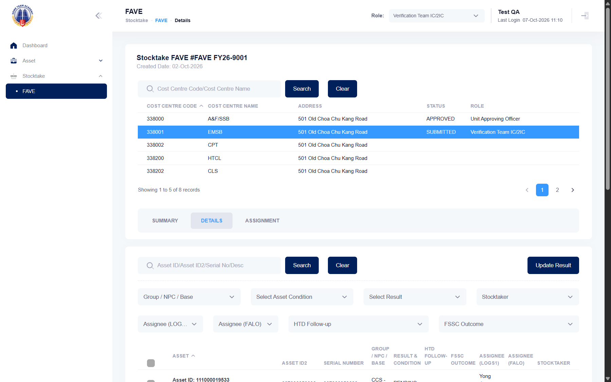
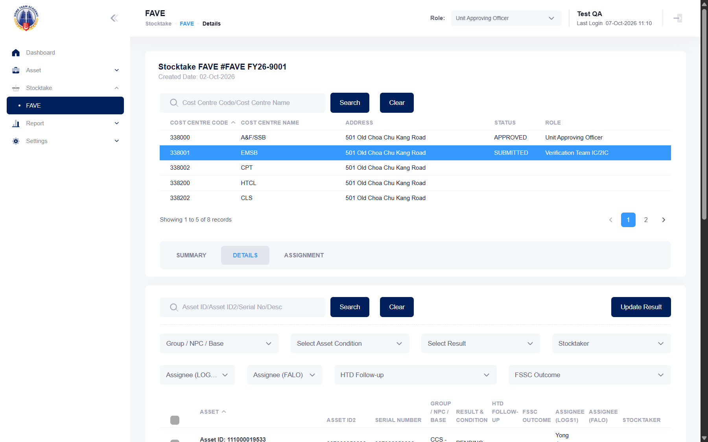

## Summary
After VET IC submits a unit's FAVE to the URO, the Details tab still shows Update Result to VET IC and saving works ("The stocktake result is updated."). The UAO also sees Update Result. Same defect as mha-spf BUG-003 (there closed as wont-fix: accepted behaviour). The manual says that once VET IC submits, the URO unlocks the update feature, and that UAO only monitors.

## Steps to reproduce
1. Log in as the HTA test account, role Verification Team IC/2IC
2. Stocktake > FAVE, open the current FAVE, pick a cost centre that is not approved (338001), Summary > Submit > Yes ("Stocktake FAVE has been submitted.")
3. Details tab: search 111000019533, tick it, Update Result, pick SIGHTED and WORKING, Submit

## Expected
After the submission VET IC can no longer change results (Update Result hidden or refused) until the FAVE is rejected back to VET IC.

## Actual
Update Result is shown and the change is saved: "The stocktake result is updated." (reproduced on HTA 2026-10-07; the asset was set back to PENDING afterwards, then the FAVE was rejected back to VET IC). As Unit Approving Officer the Details tab also shows Update Result (checked while the FAVE awaited the URO).

## Evidence
- Screenshot (VET IC after submitting; 338001 SUBMITTED): 
- Screenshot (Unit Approving Officer sees Update Result): 
- The change itself: VET IC set 111000019533 to SIGHTED / WORKING after the submit ("The stocktake result is updated."), then back to PENDING.

## Environment
- Base URL: https://mhauatwebhta.southeastasia.cloudapp.azure.com/Stocktake/FaveForm?stktakeFAVEId=<id>
- Env: staging

## History
- 2026-10-07: filed from the SPF-vs-HTA recheck; served as wont-fix like mha-spf BUG-003 (accepted behaviour).
