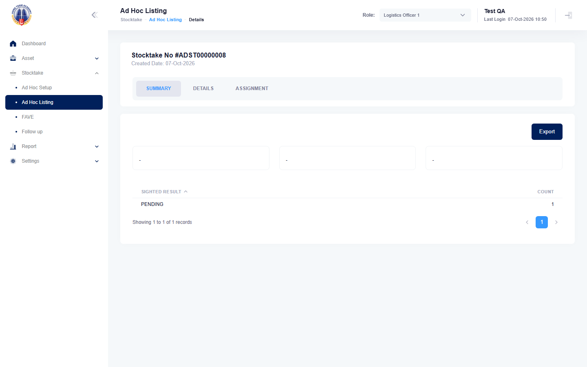

# Run report: mha-hta / playwright / staging

| Field | Value |
|---|---|
| Result | **FAIL (2 failed)** |
| Run | 2026-10-07_0948_staging_playwright |
| Runner | playwright |
| Base URL | https://mhauatwebhta.southeastasia.cloudapp.azure.com/ |
| Started | 2026-10-07 09:48 |
| Duration | 9m 29s |

## Summary

| Total | Pass | Fail | Flaky | Blocked | Skipped |
|---:|---:|---:|---:|---:|---:|
| 47 | 45 | 2 | 0 | 0 | 0 |

## Results

| ID | Title | Status | Checks | Time | Notes | Evidence |
|---|---|---|---|---|---|---|
| HTA-001 | log in with the test account from .env | pass | 24/24 | 2.6s | - | - |
| HTA-002 | switch the active role from the header role dropdown | pass | 19/19 | 5.2s | - | - |
| HTA-003 | log out ends access to protected pages | pass | 10/10 | 5.4s | - | - |
| HTA-004 | logs1 finds an asset by asset id in asset listing | pass | 14/14 | 5.6s | - | - |
| HTA-005 | logs1 filters asset listing by status | pass | 17/17 | 4.8s | - | - |
| HTA-006 | asset details show the asset header and the data tabs | pass | 31/31 | 6.0s | - | - |
| HTA-007 | logs1 walks the relocate wizard up to the location step | pass | 30/30 | 5.2s | - | - |
| HTA-008 | logs1 relocates an asset and the relocation is auto-approved | pass | 42/42 | 10.6s | - | - |
| HTA-012 | owner cancels a submitted assignment with a reason | pass | 54/54 | 9.1s | - | - |
| HTA-013 | logs1 registers a new asset with a complete location | pass | 31/31 | 11.4s | - | - |
| HTA-014 | partial registration sets progress and complete register finishes it | pass | 47/47 | 9.9s | - | - |
| HTA-015 | reject a new asset from registration and reinstate it | pass | 34/34 | 6.9s | - | - |
| HTA-016 | report a potential new asset and close it as logs1 | pass | 47/47 | 7.8s | - | - |
| HTA-017 | report a potential new asset and cancel it | pass | 36/36 | 7.7s | - | - |
| HTA-019 | vet ic views the active fave for a unit and exports it | pass | 33/33 | 7.0s | - | - |
| HTA-020 | vet ic updates a fave sighting result and htd follow-up is auto-mapped | pass | 70/70 | 22.7s | - | - |
| HTA-021 | vet ic assigns a stocktaker to a fave asset | pass | 54/54 | 20.6s | - | - |
| HTA-022 | logs1 creates a one-off ad hoc stocktake, records a result and assigns a stocktaker | pass | 81/81 | 13.2s | - | - |
| HTA-023 | logs1 creates a periodic ad hoc stocktake and cancels it with a reason | pass | 42/44 | 12.5s | BUG-002 | - |
| HTA-024 | asset listing (detailed) report filters the unit's assets and exports them to excel | pass | 18/18 | 5.5s | - | - |
| HTA-025 | vet ic submits the unit fave and uro rejects it back with a reason | pass | 80/80 | 29.7s | - | - |
| HTA-026 | fave goes from vet ic through uro to uao, and uao rejects it back to uro | pass | 80/80 | 35.4s | - | - |
| HTA-029 | logs1 reprints an rfid tag without a printer and the asset is listed as failed | pass | 30/30 | 5.8s | - | - |
| HTA-030 | print tag reason is required and others needs remarks of at most 200 characters | pass | 27/27 | 6.1s | - | - |
| HTA-031 | logs1 sets a future disposal date on a retired asset, which stays retired until that date | pass | 43/43 | 9.1s | - | - |
| HTA-032 | logs1 changes an existing disposal date | pass | 51/51 | 10.5s | - | - |
| HTA-033 | logs1 uploads a photo to an asset and deletes it | pass | 37/37 | 8.5s | - | - |
| HTA-034 | a sensitive asset (asset sensitivity yes) cannot get new photos | pass | 33/33 | 8.5s | - | - |
| HTA-035 | logs1 creates, edits and deletes a group | pass | 55/55 | 9.0s | - | - |
| HTA-036 | vet ic imports a working result file and the assets become sighted / working | pass | 53/53 | 21.1s | - | - |
| HTA-037 | fave import template downloads the lmsassetid template | pass | 14/16 | 13.5s | BUG-003 | - |
| HTA-038 | the unit reports (summary, aging, rejection, retirement, new asset, loan, maintenance) export to excel | pass | 59/59 | 6.7s | - | - |
| HTA-039 | fave incorrect location raises a relocation that logs1 approves and the asset location changes | pass | 82/82 | 29.6s | - | - |
| HTA-040 | vet ic records a not sighted result that stays open for investigation | pass | 74/74 | 22.2s | - | - |
| HTA-042 | sighted but not working maps to repair, obsolete to dispose | pass | 46/48 | 17.1s | - | - |
| HTA-043 | agency admin sees a unit fave result in fave(hq) overview, details and export | pass | 83/83 | 50.2s | - | - |
| HTA-044 | agency admin creates a user in user listing | pass | 48/48 | 9.0s | - | - |
| HTA-045 | agency admin assigns a user to a role, the user logs in with it, and the role is removed again | pass | 51/51 | 12.7s | - | - |
| HTA-046 | a user set to inactive in user listing can no longer log in | pass | 20/20 | 6.3s | - | - |
| HTA-047 | role period dialog checks required dates and the date order | pass | 27/27 | 5.5s | - | - |
| HTA-048 | role period is saved with the dates picked in the calendar | pass | 15/16 | 19.1s | BUG-004 | - |
| HTA-049 | a header announcement for today shows on the login page | pass | 33/33 | 7.2s | - | - |
| HTA-050 | agency admin updates a cost centre and name is required | pass | 26/26 | 6.0s | - | - |
| HTA-051 | cost centre search finds a cost centre by its description | pass | 13/15 | 9.3s | BUG-001 | - |
| HTA-052 | agency admin updates an email template and subject is required | pass | 24/24 | 5.4s | - | - |
| HTA-053 | logs1 creates a periodic ad hoc stocktake with random selection limited by status and max asset | fail | 67/69 | 15.4s | untriaged | [1](screenshots/HTA-053-a1-1.png) [2](traces/HTA-053-a1-3.zip) |
| HTA-054 | random ad hoc selection picks assets from at most max group / npc / base groups | fail | 21/23 | 6.6s | untriaged | [1](screenshots/HTA-054-a1-1.png) [2](traces/HTA-054-a1-3.zip) |

## Failures and warnings

### HTA-053: logs1 creates a periodic ad hoc stocktake with random selection limited by status and max asset (fail)

- Failure type: untriaged
- Source: `projects/mha-hta/tests/e2e/stocktake-adhoc/adhoc.spec.ts`
- Failed: Step: 8. Ad Hoc Listing holds the same 3 assets, all PENDING (actual: `Error: expect(locator).toHaveText(expected) failed  Locator:  locator('#tbsummary tbody tr').filter({ has: locator('td:first-child').filter({ hasText: /^\s*PENDING\s*$/ }) }).locator('td').last()`)
- Failed: Expect "toHaveText" (actual: `Error: expect(locator).toHaveText(expected) failed  Locator:  locator('#tbsummary tbody tr').filter({ has: locator('td:first-child').filter({ hasText: /^\s*PENDING\s*$/ }) }).locator('td').last()`)
- Error: Error: expect(locator).toHaveText(expected) failed  Locator:  locator('#tbsummary tbody tr').filter({ has: locator('td:first-child').filter({ hasText: /^\s*PENDING\s*$/ }) }).locator('td').last() Expected: "3" Received: "1" Timeout:  5000ms  Call log:   - Expect "toHaveText" locator('#tbsummary tbody tr').filter({ has: locator('td:first-child').filter({ hasText: /^\s*PENDING\s*$/ }) }).locator('t…

### HTA-054: random ad hoc selection picks assets from at most max group / npc / base groups (fail)

- Failure type: untriaged
- Source: `projects/mha-hta/tests/e2e/stocktake-adhoc/adhoc.spec.ts`
- Failed: Step: 3. Max Group / NPC / Base 1: at most 1 group(s) in 5 searches (mha-spf BUG-016) (actual: `Error: search 4: 4 assets from 3 groups  expect(received).toBeLessThanOrEqual(expected)`)
- Failed: search 4: 4 assets from 3 groups (actual: `Error: search 4: 4 assets from 3 groups  expect(received).toBeLessThanOrEqual(expected)`)
- Error: Error: search 4: 4 assets from 3 groups  expect(received).toBeLessThanOrEqual(expected)  Expected: <= 1 Received:    3

## Notes

Playwright project "mha-hta". Full Playwright HTML report: reports/playwright-html/index.html, open with npm run report (overwritten by the next run).
