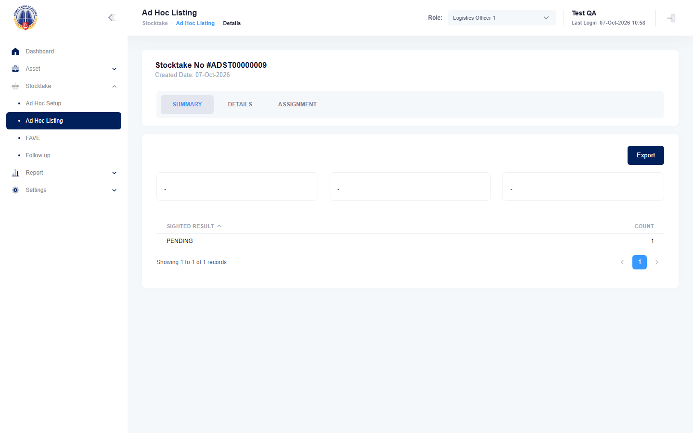

# Run report: mha-hta / playwright / staging

| Field | Value |
|---|---|
| Result | **FAIL (1 failed)** |
| Run | 2026-10-07_1000_staging_playwright |
| Runner | playwright |
| Base URL | https://mhauatwebhta.southeastasia.cloudapp.azure.com/ |
| Started | 2026-10-07 10:00 |
| Duration | 25.7s |

## Summary

| Total | Pass | Fail | Flaky | Blocked | Skipped |
|---:|---:|---:|---:|---:|---:|
| 2 | 1 | 1 | 0 | 0 | 0 |

## Results

| ID | Title | Status | Checks | Time | Notes | Evidence |
|---|---|---|---|---|---|---|
| HTA-053 | logs1 creates a periodic ad hoc stocktake with random selection limited by status and max asset | fail | 67/69 | 18.0s | untriaged | [1](screenshots/HTA-053-a1-1.png) [2](traces/HTA-053-a1-3.zip) |
| HTA-054 | random ad hoc selection picks assets from at most max group / npc / base groups | pass | 15/17 | 6.0s | BUG-005 | - |

## Failures and warnings

### HTA-053: logs1 creates a periodic ad hoc stocktake with random selection limited by status and max asset (fail)

- Failure type: untriaged
- Source: `projects/mha-hta/tests/e2e/stocktake-adhoc/adhoc.spec.ts`
- Failed: Step: 8. Ad Hoc Listing holds the same 3 assets, all PENDING (BUG-006) (actual: `Error: expect(locator).toHaveText(expected) failed  Locator:  locator('#tbsummary tbody tr').filter({ has: locator('td:first-child').filter({ hasText: /^\s*PENDING\s*$/ }) }).locator('td').last()`)
- Failed: Expect "toHaveText" (actual: `Error: expect(locator).toHaveText(expected) failed  Locator:  locator('#tbsummary tbody tr').filter({ has: locator('td:first-child').filter({ hasText: /^\s*PENDING\s*$/ }) }).locator('td').last()`)
- Error: Error: expect(locator).toHaveText(expected) failed  Locator:  locator('#tbsummary tbody tr').filter({ has: locator('td:first-child').filter({ hasText: /^\s*PENDING\s*$/ }) }).locator('td').last() Expected: "3" Received: "1" Timeout:  5000ms  Call log:   - Expect "toHaveText" locator('#tbsummary tbody tr').filter({ has: locator('td:first-child').filter({ hasText: /^\s*PENDING\s*$/ }) }).locator('t…

## Notes

Playwright project "mha-hta". Full Playwright HTML report: reports/playwright-html/index.html, open with npm run report (overwritten by the next run).
