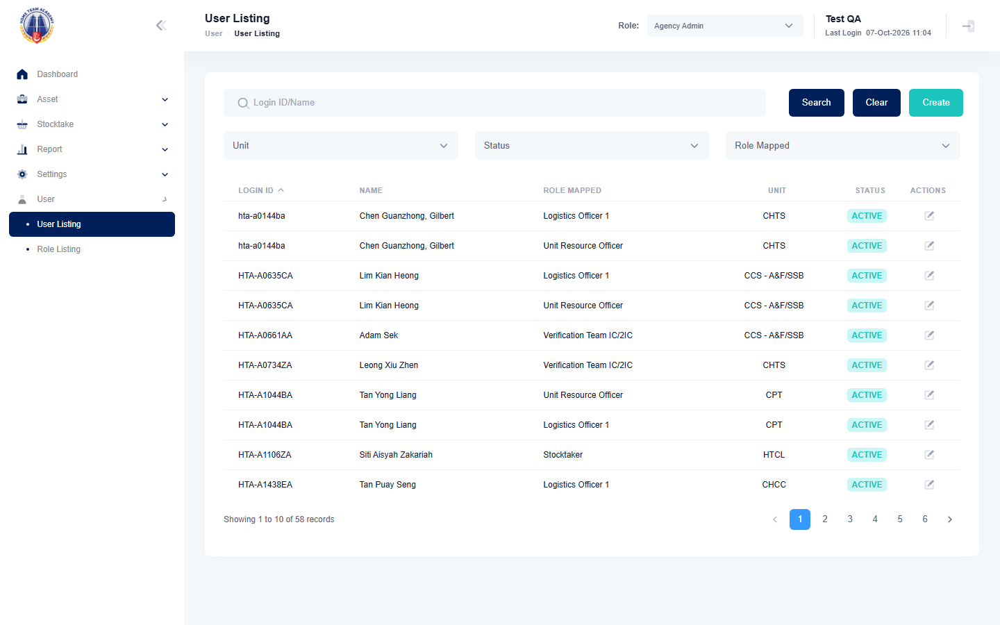

# Run report: mha-hta / playwright / staging

| Field | Value |
|---|---|
| Result | **FAIL (1 failed)** |
| Run | 2026-10-07_1006_staging_playwright |
| Runner | playwright |
| Base URL | https://mhauatwebhta.southeastasia.cloudapp.azure.com/ |
| Started | 2026-10-07 10:06 |
| Duration | 1m 5s |

## Summary

| Total | Pass | Fail | Flaky | Blocked | Skipped |
|---:|---:|---:|---:|---:|---:|
| 2 | 1 | 1 | 0 | 0 | 0 |

## Results

| ID | Title | Status | Checks | Time | Notes | Evidence |
|---|---|---|---|---|---|---|
| HTA-027 | uao approves a unit fave after vet ic and uro submit, and it becomes final | pass | 84/85 | 39.3s | - | - |
| HTA-055 | agency admin deletes a user, who disappears from the lists and can no longer log in | fail | 34/35 | 24.7s | untriaged | [1](screenshots/HTA-055-a1-1.png) [2](screenshots/HTA-055-a1-2.png) [3](traces/HTA-055-a1-4.zip) |

## Failures and warnings

### HTA-055: agency admin deletes a user, who disappears from the lists and can no longer log in (fail)

- Failure type: untriaged
- Source: `projects/mha-hta/tests/e2e/user-admin/users.spec.ts`
- Failed: Step: 1. Create QA-AUTO-MUXJ0OGR and add it to Stocktaker (actual: `TimeoutError: locator.click: Timeout 15000ms exceeded. Call log:   - waiting for getByRole('button', { name: 'Add User', exact: true })`)
- Error: TimeoutError: locator.click: Timeout 15000ms exceeded. Call log:   - waiting for getByRole('button', { name: 'Add User', exact: true }) 

## Notes

Playwright project "mha-hta". Full Playwright HTML report: reports/playwright-html/index.html, open with npm run report (overwritten by the next run).
