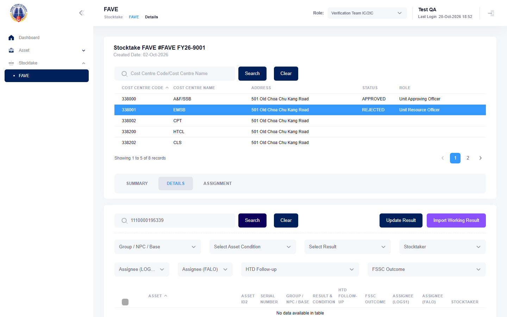

# Run report: mha-hta / playwright / staging

| Field | Value |
|---|---|
| Result | **FAIL (1 failed)** |
| Run | 2026-10-21_0953_staging_playwright |
| Runner | playwright |
| Base URL | https://mhauatwebhta.southeastasia.cloudapp.azure.com/ |
| Started | 2026-10-21 09:53 |
| Duration | 1m 5s |

## Summary

| Total | Pass | Fail | Flaky | Blocked | Skipped |
|---:|---:|---:|---:|---:|---:|
| 1 | 0 | 1 | 0 | 0 | 0 |

## Results

| ID | Title | Status | Checks | Time | Notes | Evidence |
|---|---|---|---|---|---|---|
| HTA-036 | vet ic imports a working result file and the assets become sighted / working | fail | 20/23 | 1m 3s | test-issue; attempt 2 | [1](screenshots/HTA-036-a1-1.png) [2](traces/HTA-036-a1-3.zip) [3](screenshots/HTA-036-a2-1.png) [4](traces/HTA-036-a2-3.zip) |

## Failures and warnings

### HTA-036: vet ic imports a working result file and the assets become sighted / working (fail)

- Failure type: test-issue
- Source: `projects/mha-hta/tests/e2e/stocktake-fave/fave-import.spec.ts`
- Failed: Step: 1-2. Open the FAVE on 338001 with 1110000195339 PENDING, choose a file with 1110000195339 (actual: `Error: expect(locator).toHaveCount(expected) failed  Locator:  locator('#tbdetail tbody tr').filter({ hasText: 'Asset ID: 1110000195339' })`)
- Failed: Expect "toHaveCount" (actual: `Error: expect(locator).toHaveCount(expected) failed  Locator:  locator('#tbdetail tbody tr').filter({ hasText: 'Asset ID: 1110000195339' })`)
- Failed: Expect "toHaveCount" (actual: `Error: expect(locator).toHaveCount(expected) failed  Locator:  locator('#tbdetail tbody tr').filter({ hasText: 'Asset ID: 1110000195339' })`)
- Error: Error: expect(locator).toHaveCount(expected) failed  Locator:  locator('#tbdetail tbody tr').filter({ hasText: 'Asset ID: 1110000195339' }) Expected: 1 Received: 0 Timeout:  5000ms  Call log:   - Expect "toHaveCount" locator('#tbdetail tbody tr').filter({ hasText: 'Asset ID: 1110000195339' }) with timeout 5000ms   - waiting for locator('#tbdetail tbody tr').filter({ hasText: 'Asset ID: 1110000195…
- Earlier attempt: fail (failed: Step: 1-2. Open the FAVE on 338001 with 1110000195339 PENDING, choose a file with 1110000195339; Expect "toHaveCount"; Expect "toHaveCount")
- Note: FavePage.firstAssetId read the row text of the hidden Details tab, which has no line breaks: the description "9I030 PANIC ALARM SYSTEM" ran into the ID (1110000195339 instead of 111000019533). Fixed with StocktakeFormPage.assetIdOf (reads the "Asset ID: <id>" line); passes in run 2026-10-21_0956

## Notes

Playwright project "mha-hta". Full Playwright HTML report: reports/playwright-html/index.html, open with npm run report (overwritten by the next run).
