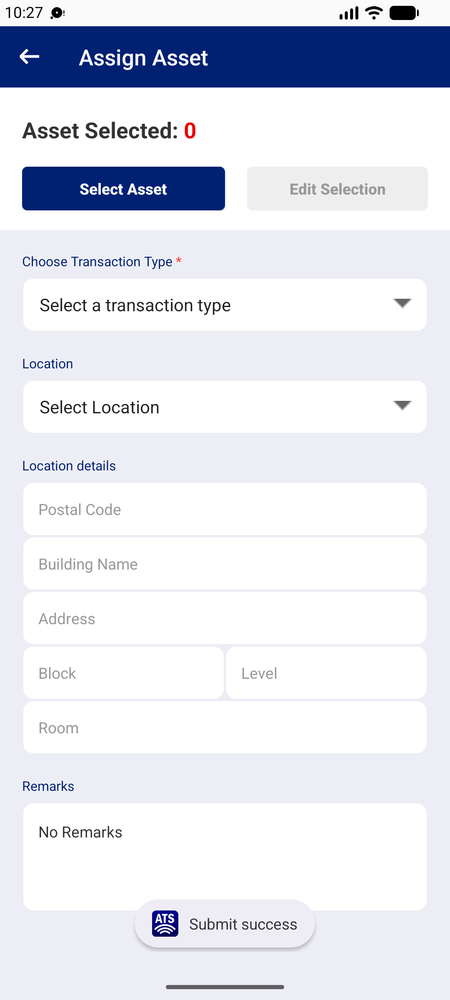

## Summary
In the Relocate form the user can overwrite the pre-filled postal code with any 6 digits. If no address matches (no 'Select Address:-' list), Building Name and Address keep the old address, and Complete saves the new postal code with the old address. The asset's location on web becomes inconsistent. New Asset blocks the same case with 'Please input location'.

## Steps to reproduce
1. Mobile app: Logistics Officer 1 | 332600 > Assign > Select Asset > 111000011297 > + > close
2. Transaction type RELOCATE: form pre-fills postal 819645, AIRPORT POLICE STATION, 35 AIRPORT BOULEVARD ... SINGAPORE 819645
3. Clear Postal Code and type 000099 (no address list opens); Building/Address still show the 819645 address
4. Tap Complete
5. MHA web: asset 111000011297 > Location

## Expected
Complete is refused until the postal code is matched to an address from the list (as New Asset does: 'Please input location'), or Building/Address are cleared when the postal code changes.

## Actual
Toast 'Submit success'. Web Asset Location: Postal Code 000099, Building AIRPORT POLICE STATION, Address '35 AIRPORT BOULEVARD AIRPORT POLICE STATION SINGAPORE 819645', Remarks 'No Remarks' (BUG-002). Transaction ASG00006469 APPROVED at once. Cleaned up the same session with a second relocate to 819645 (ASG00006470).

## Evidence
- Screenshot: 
- Web Location tab text quoted above

## Environment
- Base URL: Mobile app Assign > Relocate; checked on https://mhauatweb.southeastasia.cloudapp.azure.com/Asset/Asset (Asset Details > Location)
- Env: staging

## History
- 2026-10-22: filed from explorations/2026-10-22-bug-hunt-edges.md in the Test Manager app.
