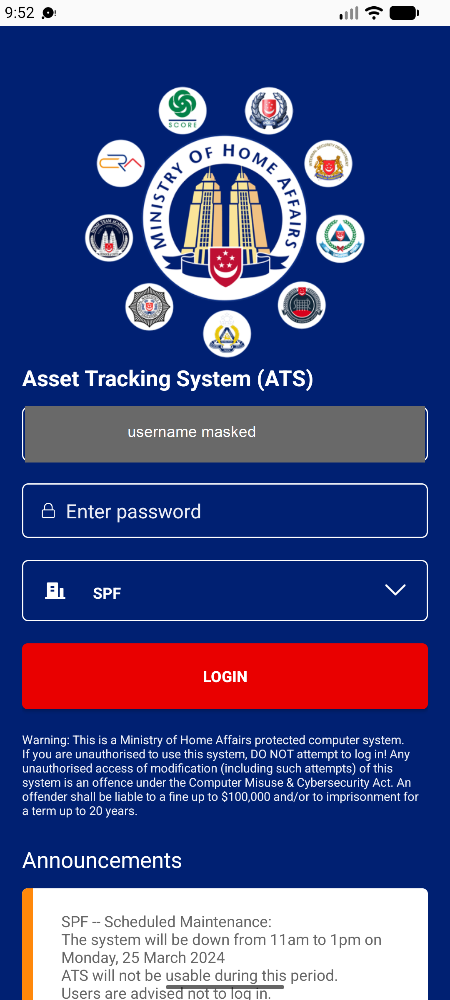

## Summary
Three quick taps on LOGIN send three login requests at once. One is refused (142-byte reply, one session per account), the app stays on the login screen with no message, and from then on LOGIN does nothing (no request at all) until the app is force-stopped and reopened. Two quick taps happened to work.

## Steps to reproduce
1. Mobile app login screen: username = MHM_USER, password empty, agency SPF
2. Tap LOGIN three times quickly (adb: input tap x3 within ~0.3 s)
3. Wait 10 s, then tap LOGIN once more; wait 30 s and tap again

## Expected
LOGIN is disabled while a login is in progress (one request), and the user lands on home; a refused attempt shows a message and LOGIN works again.

## Actual
logcat: three login bursts within 60 ms, one 'Response Size: 142 bytes'. Screen stays on login, no message. Later taps send no request (no 'Response Size' lines). Works only after force-stop + reopen. Reproduced 2/2 (09:51 and 09:55 WIB).

## Evidence
- Screenshot (username masked): 

## Environment
- Base URL: Mobile app login screen
- Env: staging

## History
- 2026-10-22: filed from explorations/2026-10-22-bug-hunt-edges.md in the Test Manager app.
