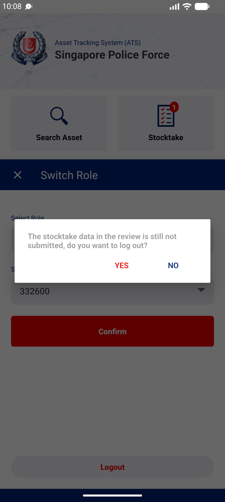

## Summary
With saved but unsent sightings in REVIEW, Logout asks 'The stocktake data in the review is still not submitted, do you want to log out?'. YES logs out and the sightings are gone after the next login (REVIEW 0, assets back in SELECT). The same items survive a force-stop and a cost centre switch, so they are deleted on purpose at logout without saying so.

## Steps to reproduce
1. Stocktaker | 332600 with FAVE assets assigned (web FAVE > Assignment)
2. Open the FAVE online, sight two assets (SAVE > CONFIRM): REVIEW 2
3. Exit the FAVE, Switch > Logout > YES
4. Log in, Stocktaker | 332600, open the FAVE

## Expected
Unsent sightings are kept for the same user after logging in again (as after an app kill), or the warning says plainly that the sightings will be deleted.

## Actual
SELECT 3, REVIEW 0: both sightings lost. Web still PENDING.

## Evidence
- Screenshot: 

## Environment
- Base URL: Mobile app home > Switch > Logout (FAVE REVIEW tab)
- Env: staging

## History
- 2026-10-22: filed from explorations/2026-10-22-bug-hunt-edges.md in the Test Manager app.
