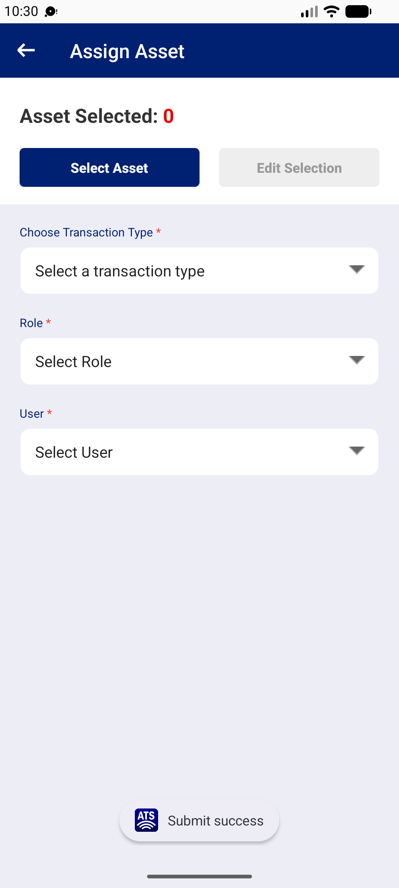
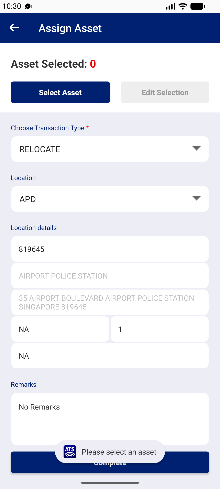

## Summary
After the last asset is removed in Edit Selection, Asset Selected shows 0 but Complete stays visible. With transaction type ASSIGN, Complete sends a request (42-byte reply), resets the form and toasts 'Submit success', though nothing was assigned. With RELOCATE the same state is refused with 'Please select an asset'.

## Steps to reproduce
1. Logistics Officer 1 | 332600 > Assign > Select Asset > search 111000011297 > + > close (Asset Selected 1)
2. Edit Selection > tap the asset's action box to remove it > close (Asset Selected 0, Complete still shown)
3. Transaction type ASSIGN, Role Fixed Asset Liaison Officer, User Alim s/o Syed Ibrahim
4. Tap Complete

## Expected
'Please select an asset' (as RELOCATE does), or Complete hidden when 0 assets are selected.

## Actual
Toast 'Submit success', form reset. No transaction appears on web. Reproduced 2/2 (10:22, 10:30 WIB).

## Evidence
- Screenshot: 
- RELOCATE for comparison: 

## Environment
- Base URL: Mobile app Assign > Edit Selection > ASSIGN > Complete
- Env: staging

## History
- 2026-10-22: filed from explorations/2026-10-22-bug-hunt-edges.md in the Test Manager app.
- 2026-10-22: Also reproduces on HTA (QA_ENV=staging-hta, Logistics Officer 1 | 338000): 'Submit success' with 0 assets (explorations/2026-10-22-bug-hunt-untouched.md).
