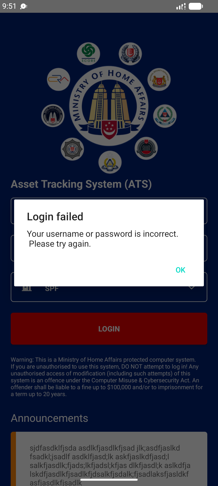

## Summary
With Wi-Fi and mobile data off, LOGIN shows 'Login failed / Your username or password is incorrect. Please try again.' The account is fine; the phone is offline. In production (3 failed attempts lock the account per the manual) users will retype passwords or call the helpdesk for nothing.

## Steps to reproduce
1. adb shell svc wifi disable; svc data disable
2. Login screen: username = MHM_USER, agency SPF, LOGIN

## Expected
A connectivity message such as 'Please Switch ON the internet' (the app already has this string).

## Actual
'Login failed' / 'Your username or password is incorrect. Please try again.' Reproduced 2/2; logging in works as soon as the network is back.

## Evidence
- Screenshot: 

## Environment
- Base URL: Mobile app login screen
- Env: staging

## History
- 2026-10-22: filed from explorations/2026-10-22-bug-hunt-edges.md in the Test Manager app.
- 2026-10-22: Also reproduces on HTA (agency HTA, MHM_HTA_USER).
