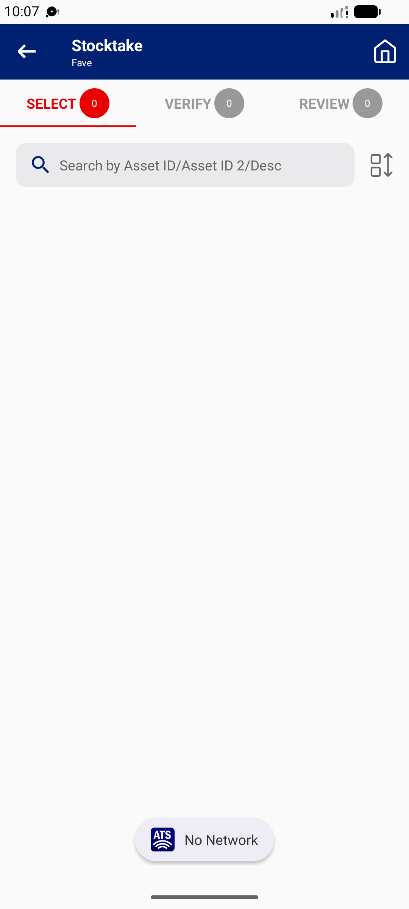

## Summary
In online mode, if the network drops before SAVE > CONFIRM, the app toasts 'No Network' and the FAVE screen shows 0 / 0 / 0 with empty lists, including a sighting saved earlier. Nothing is lost: after the network returns and the user switches tabs, REVIEW shows both items. But the blank screen tells the user their work is gone.

## Steps to reproduce
1. Stocktaker | 332600, open the FAVE > CANCEL (online); sight one asset (REVIEW 1)
2. Open a second asset, turn Sighted on, type remarks
3. Turn off Wi-Fi and data, SAVE > CONFIRM
4. Wait 15 s; turn the network on; tap REVIEW, then SELECT

## Expected
The sighting is stored and the tabs keep their counts (SELECT 1, REVIEW 2), with a note that it will be uploaded at Submit; or a clear error that keeps the user on the asset.

## Actual
Toast 'No Network', then SELECT 0 / VERIFY 0 / REVIEW 0 and empty lists until a tab is tapped with the network back (then SELECT 1, REVIEW 2). The emptied location group also stays as '0 Assets'.

## Evidence
- Screenshot: 

## Environment
- Base URL: Mobile app Stocktake > FAVE (online mode) > StockTake Detail > SAVE
- Env: staging

## History
- 2026-10-22: filed from explorations/2026-10-22-bug-hunt-edges.md in the Test Manager app.
