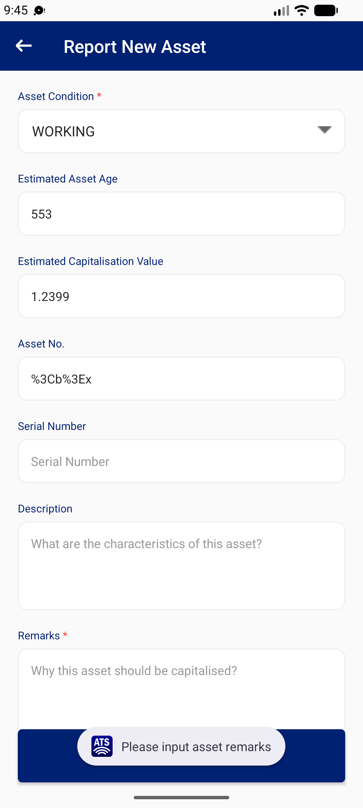

## Summary
Remarks* is required: an empty box gives 'Please input asset remarks'. Three spaces pass that check and Save moves on to the next field ('Please input postal code').

## Steps to reproduce
1. Stocktaker | 332140 > New Asset
2. Asset Condition WORKING; Remarks = three spaces; leave the rest empty; SAVE
3. Clear Remarks completely; SAVE

## Expected
Whitespace-only Remarks is treated as empty: 'Please input asset remarks'.

## Actual
Step 2: 'Please input postal code' (Remarks value read from the screen: three spaces). Step 3: 'Please input asset remarks'.

## Evidence
- Screenshot: 
- Screenshot: 

## Environment
- Base URL: Mobile app New Asset (Report New Asset)
- Env: staging

## History
- 2026-10-22: filed from explorations/2026-10-22-bug-hunt-edges.md in the Test Manager app.
