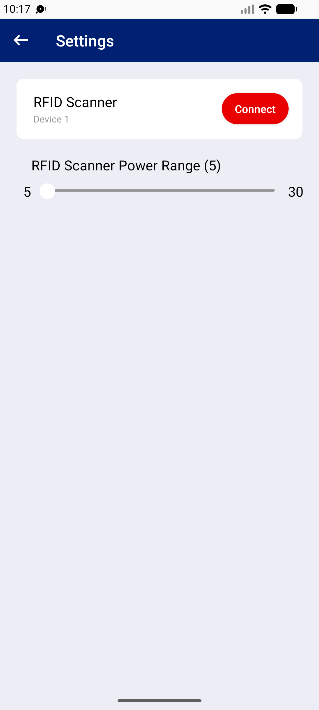

## Summary
Connect asks for the location permission (needed for the Bluetooth scan). If the user taps 'Don't allow' twice, Android stops asking, and from then on Connect does nothing: no message, no link to the app settings, so the RFID scanner can never be paired.

## Steps to reproduce
1. Any unit role > Settings > Connect > 'Allow ATS to access this device's location?' > Don't allow
2. Connect > Don't allow again
3. Connect

## Expected
A message explaining that location access is needed for the scanner, with a button to open the app's permission settings.

## Actual
Nothing happens; no dialog, no toast (2 taps checked). No crash.

## Evidence
- Screenshot: 

## Environment
- Base URL: Mobile app Settings (RFID Scanner > Connect)
- Env: staging

## History
- 2026-10-22: filed from explorations/2026-10-22-bug-hunt-edges.md in the Test Manager app.
