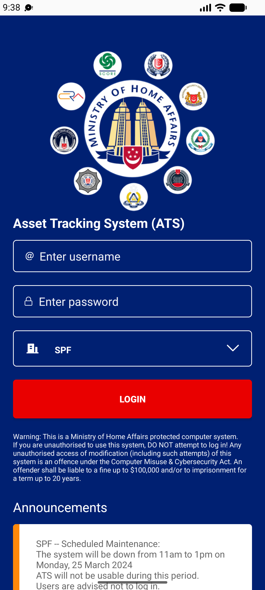

## Summary
LOGIN with an empty username does nothing: no message, no request. Users cannot tell whether the tap registered.

## Steps to reproduce
1. Login screen, username and password empty, agency SPF
2. Tap LOGIN

## Expected
'Please enter your username' (or the username field marked as required).

## Actual
No dialog, no toast, no request (3 taps checked).

## Evidence
- Screenshot: 

## Environment
- Base URL: Mobile app login screen
- Env: staging

## History
- 2026-10-22: filed from explorations/2026-10-22-bug-hunt-edges.md in the Test Manager app.
