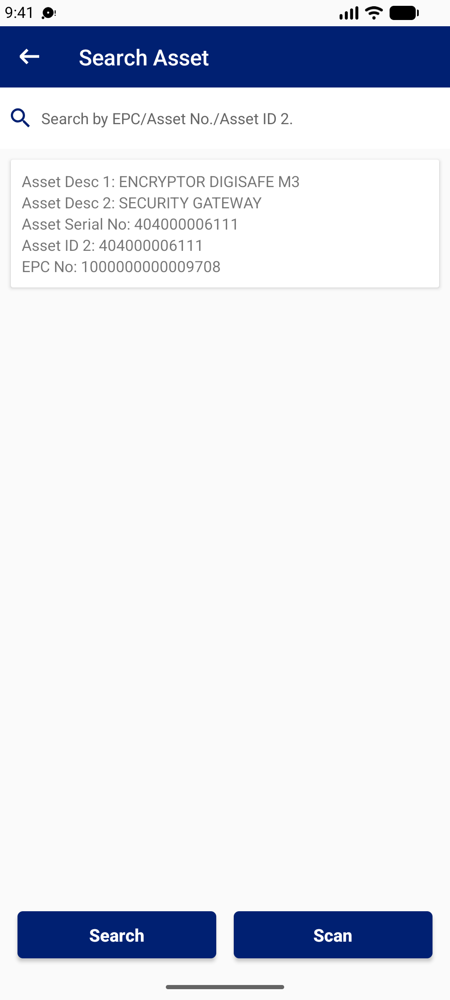
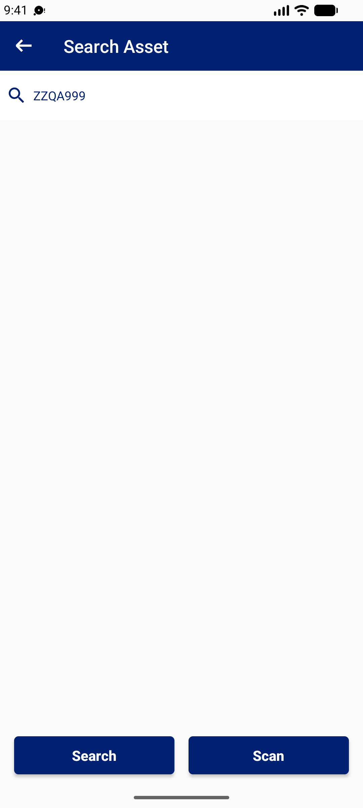

## Summary
Search with an empty keyword sends no request and keeps the previous result on screen under an empty search box. A keyword with no match (ZZQA999, '%', a partial Asset ID) shows an empty list with no 'no record found' message, the same as an asset of another cost centre.

## Steps to reproduce
1. Stocktaker | 332140 > Search Asset > search 602000003903 (1 result)
2. Clear the box, Search
3. Search ZZQA999

## Expected
Empty keyword: 'Please enter a keyword' and the old result cleared. No match: 'No asset found' (ideally saying that only the active cost centre is searched).

## Actual
Step 2: the 602000003903 result stays. Step 3: blank list, no message (request made, 661-byte reply).

## Evidence
- Screenshot: 
- Screenshot: 

## Environment
- Base URL: Mobile app Search Asset
- Env: staging

## History
- 2026-10-22: filed from explorations/2026-10-22-bug-hunt-edges.md in the Test Manager app.
