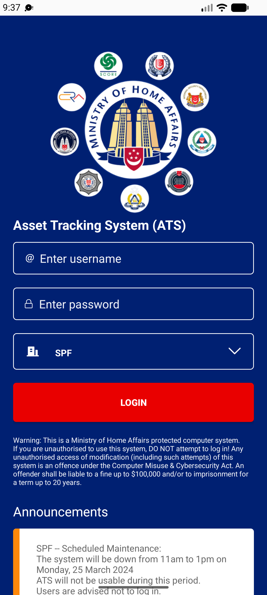
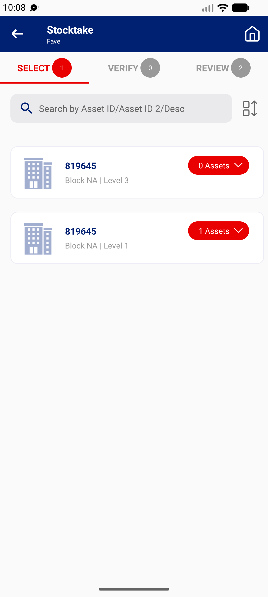
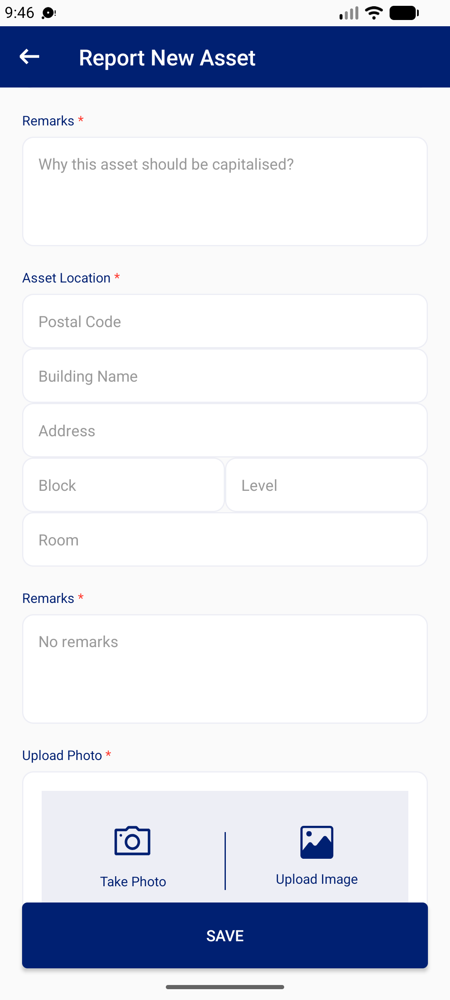

## Summary
Small text problems seen in one session; each is a one-line fix.

## Steps to reproduce
1. Login screen warning: 'Any unauthorised access of modification' (should be 'or modification'); MHA web says 'access or use'
2. FAVE SELECT location group pill: '1 Assets' (singular), and a group whose assets are all sighted stays listed as '0 Assets'
3. New Asset > Estimated Capitalisation Value hint 'E.g. $10.000' (should be $10,000)
4. New Asset > location Remarks* is required but its hint reads 'No remarks'
5. Search Asset detail and StockTake Detail: 'Description *' with a required asterisk on read-only fields
6. Search Asset hint 'Search by EPC/Asset No./Asset ID 2.' leaves out Serial No., which also works (manual lists serial no., EPC, Asset No, Asset ID, Asset ID 2)

## Expected
Correct spelling and plurals, '$10,000', hints that match the field's rule, no required marker on read-only fields.

## Actual
As listed in the steps.

## Evidence
- Screenshot: 
- Screenshot: 
- Screenshot: 

## Environment
- Base URL: Mobile app: login, Stocktake FAVE SELECT, New Asset, Search Asset
- Env: staging

## History
- 2026-10-22: filed from explorations/2026-10-22-bug-hunt-edges.md in the Test Manager app.
