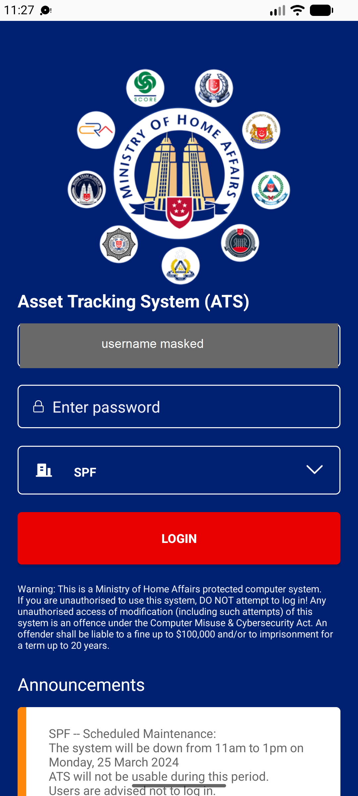

## Summary
Ad hoc results saved to REVIEW but not submitted are deleted when the user logs out, and Logout shows no warning at all. For FAVE stocktakes the app at least asks 'The stocktake data in the review is still not submitted, do you want to log out?' (BUG-010). The ad hoc back arrow leaves the screen without the 'exit without uploading' warning too.

## Steps to reproduce
1. MHA web (LOGS1): Ad Hoc Setup > Create One-Off, Manual, two assets of 332100 (ADST00000037: 111000021250, 111000021888) > Ad Hoc Listing > Assignment > Assign Stocktaker = Tan Jun Yong Shawn
2. Mobile app (MHM_USER): Stocktaker | 332100 > Stocktake (Ad Hoc) > ADST00000037 > CONFIRM (offline) or CANCEL (online)
3. Save results for both assets (REVIEW 2), or one (REVIEW 1)
4. Back arrow to the list, Back to home, Switch > Logout
5. Log in, Stocktaker | 332100, open ADST00000037

## Expected
A warning before logout that unsent ad hoc results exist (as for FAVE), and the results kept for the next login.

## Actual
Logout goes straight to the login screen with no dialog. After logging in: SELECT 2, REVIEW 0, results lost; web still PENDING. Reproduced 2/2 (offline mode at 11:25 WIB, online mode at 11:28 WIB).

## Evidence
- Screenshot (username masked): 
- Session notes: ../explorations/2026-10-22-bug-hunt-untouched.md

## Environment
- Base URL: Mobile app Stocktake (Ad Hoc) > REVIEW; home > Switch > Logout
- Env: staging

## History
- 2026-10-22: filed from explorations/2026-10-22-bug-hunt-untouched.md in the Test Manager app.
