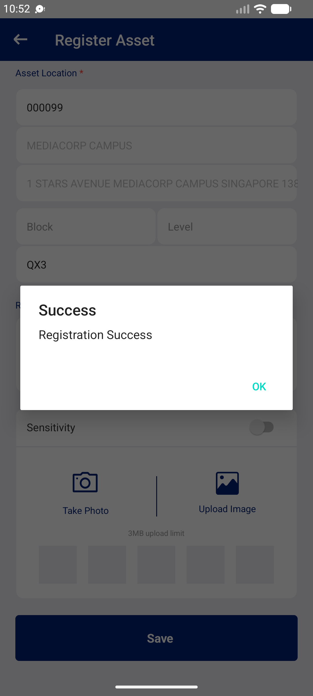

## Summary
Same defect as BUG-008 (Relocate) in the Register Asset form: the pre-filled postal code can be replaced by any 6 digits; when no address matches, Building and Address keep the old values and Save registers the asset with the new postal code and the old address. Registration cannot be undone.

## Steps to reproduce
1. Mobile app: Logistics Officer 1 | 332140 > Asset Registration > 602000003903 (PROGRESS; postal 138507, MEDIACORP CAMPUS)
2. Clear Postal Code, type 000099 (no address list opens)
3. Room = QX3, Save
4. MHA web: asset 602000003903 > Location

## Expected
Save refused until the postal code is matched to an address from the list (New Asset does this: 'Please input location').

## Actual
Dialog 'Success / Registration Success', list 51 -> 50. Web: status AVAILABLE, Asset Location Postal Code 000099, Building MEDIACORP CAMPUS, Address '1 STARS AVENUE MEDIACORP CAMPUS SINGAPORE 138507', Room QX3. Fixed afterwards with a phone relocation to 138507 (ASG00006472).

## Evidence
- Screenshot: 
- Related: BUG-008 (Relocate)

## Environment
- Base URL: Mobile app Asset Registration (Register Asset); checked on https://mhauatweb.southeastasia.cloudapp.azure.com/Asset/Asset (Asset Details > Location)
- Env: staging

## History
- 2026-10-22: filed from explorations/2026-10-22-bug-hunt-untouched.md in the Test Manager app.
