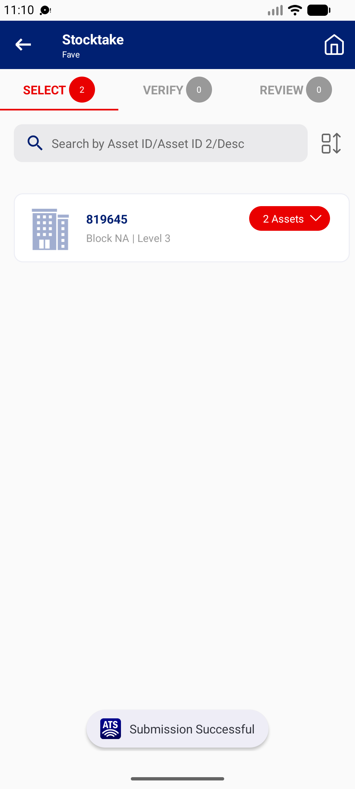

## Summary
The stocktaker downloads a FAVE (offline mode) and sights an asset. Before Submit, VET IC reassigns that asset to another stocktaker on web. Submit still uploads the sighting, and web shows the result with the new stocktaker's name, so the record says a person sighted an asset they never touched. The phone gets no warning.

## Steps to reproduce
1. Web VET IC: FAVE FY26-2001 / 332600, 111000010978 assigned to Tan Jun Yong Shawn, PENDING
2. Phone (Tan): Stocktaker | 332600 > FAVE > CONFIRM (download); network off; sight 111000010978 with remarks (REVIEW 1); network on
3. Web VET IC: FAVE > Assignment > 111000010978 > Assign Stocktaker = Wong Pui Lai Annie
4. Phone: reopen the FAVE (online) > REVIEW > Submit
5. Web: FAVE > Details > 111000010978

## Expected
The upload is refused for an asset no longer assigned to this stocktaker (with a message), or the result keeps the name of the officer who actually sighted it.

## Actual
Phone: REVIEW 0, no message (33-byte reply). Web Details: 'SIGHTED WORKING No Further Action Working condition', Stocktaker 'Wong Pui Lai Annie'. Reset to PENDING and reassigned to Tan afterwards.

## Evidence
- Screenshot: 
- Web Details row text quoted above (2026-10-22 11:11 WIB)

## Environment
- Base URL: Mobile app Stocktake > FAVE (offline mode) > Submit; MHA web Stocktake > FAVE > Details
- Env: staging

## History
- 2026-10-22: filed from explorations/2026-10-22-bug-hunt-untouched.md in the Test Manager app.
