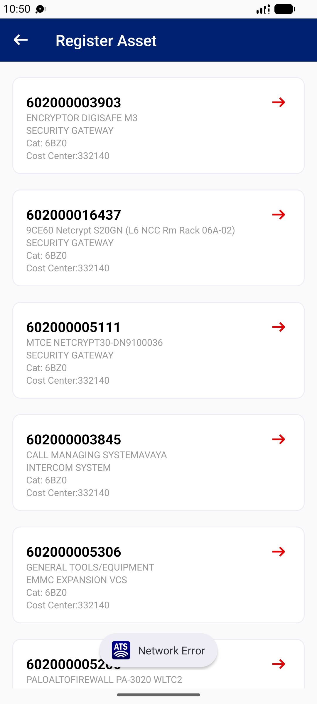

## Summary
Save with no network toasts 'Network Error' and returns to the Register Asset list; the fields typed (room, remarks) are gone when the asset is opened again. The header also loses its count until the list is reloaded.

## Steps to reproduce
1. Logistics Officer 1 | 332140 > Asset Registration > 602000003903
2. Type Room QX1
3. Turn off Wi-Fi and data, tap Save
4. Turn the network on, open the asset again

## Expected
A connectivity message that keeps the user on the form with the data, so Save can be retried.

## Actual
Toast 'Network Error', back on the list (header 'Register Asset' without '(51)'); reopened form: Room empty. Reproduced 2/2.

## Evidence
- Screenshot: 

## Environment
- Base URL: Mobile app Asset Registration (Register Asset form)
- Env: staging

## History
- 2026-10-22: filed from explorations/2026-10-22-bug-hunt-untouched.md in the Test Manager app.
