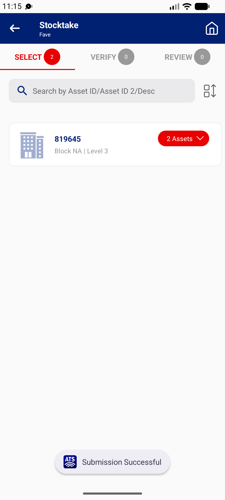

## Summary
The phone's Remarks box has no length limit. A 262-character remark is saved and submitted without a message, and MHA web stores only the first 200 characters (web shows '200 / 200'). The end of the stocktaker's note is lost.

## Steps to reproduce
1. Stocktaker | 332600 > FAVE > 111000010978 > Sighted on
2. Remarks: 262 characters (QA + 0123456789 x 26)
3. SAVE > CONFIRM > REVIEW > Submit
4. Web VET IC: FAVE > Details > 111000010978 > Update Result

## Expected
The phone limits Remarks to 200 characters (with a counter, like web), or the server rejects the upload with a message.

## Actual
Phone field length 262, Submit succeeds. Web Remarks length 200 ('200 / 200'), ending '...678901234567'.

## Evidence
- Screenshot: 

## Environment
- Base URL: Mobile app StockTake Detail > Remarks; MHA web FAVE > Update Result (Remarks n / 200)
- Env: staging

## History
- 2026-10-22: filed from explorations/2026-10-22-bug-hunt-untouched.md in the Test Manager app.
