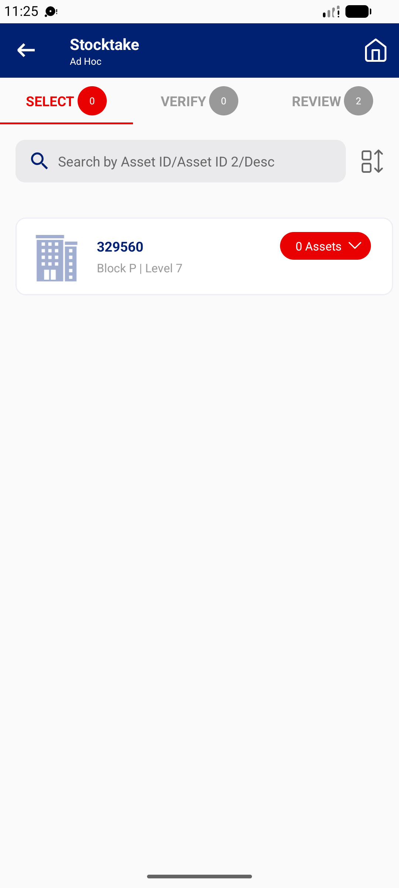

## Summary
The house icon at the top right of an open ad hoc stocktake does not react, in offline and online mode, with or without unsent results. On a FAVE the same button asks 'Are you sure you want to exit without uploading?' and goes home. Users have to use the back arrow twice.

## Steps to reproduce
1. Stocktaker | 332100 > Stocktake (Ad Hoc) > ADST00000037 > CONFIRM or CANCEL
2. Save a result (REVIEW 1) or not
3. Tap the Home icon (top right)

## Expected
Same as FAVE: the exit warning when results are unsent, then the home screen.

## Actual
Nothing happens (4 taps across offline and online mode; no dialog, no log error). The back arrow works.

## Evidence
- Screenshot: 

## Environment
- Base URL: Mobile app Stocktake (Ad Hoc) > an ad hoc stocktake (SELECT / VERIFY / REVIEW)
- Env: staging

## History
- 2026-10-22: filed from explorations/2026-10-22-bug-hunt-untouched.md in the Test Manager app.
