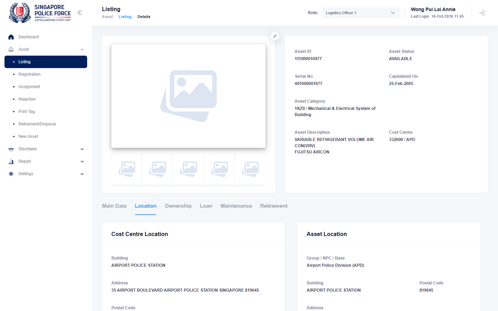

# Run report: mha-mobile / playwright / staging

| Field | Value |
|---|---|
| Result | **FAIL (1 failed)** |
| Run | 2026-10-16_1121_staging_playwright |
| Runner | playwright |
| Base URL | https://mhauatweb.southeastasia.cloudapp.azure.com/ |
| Started | 2026-10-16 11:21 |
| Duration | 7m 1s |

## Summary

| Total | Pass | Fail | Flaky | Blocked | Skipped |
|---:|---:|---:|---:|---:|---:|
| 2 | 1 | 1 | 0 | 0 | 0 |

## Results

| ID | Title | Status | Checks | Time | Notes | Evidence |
|---|---|---|---|---|---|---|
| MHM-008 | relocation made on the mobile app is approved and moves the asset on mha web | pass | 121/121 | 3m 35s | - | - |
| MHM-010 | new asset reported on the mobile app shows on mha web | fail | 85/87 | 3m 22s | untriaged | [1](screenshots/MHM-010-a1-1.png) [2](traces/MHM-010-a1-3.zip) |

## Failures and warnings

### MHM-010: new asset reported on the mobile app shows on mha web (fail)

- Failure type: untriaged
- Source: `projects/mha-mobile/tests/e2e/new-asset/new-asset.spec.ts`
- Failed: Step: 5. Upload Image > the newest photo (qa-mobile-mvags4yw.png) (actual: `ExpectError: Expected element to be visible, but it was not`)
- Failed: Step: expect.toBeVisible() (actual: `ExpectError: Expected element to be visible, but it was not`)
- Error: ExpectError: Expected element to be visible, but it was not

## Notes

Playwright project "mha-mobile". Full Playwright HTML report: reports/playwright-html/index.html, open with npm run report (overwritten by the next run).
