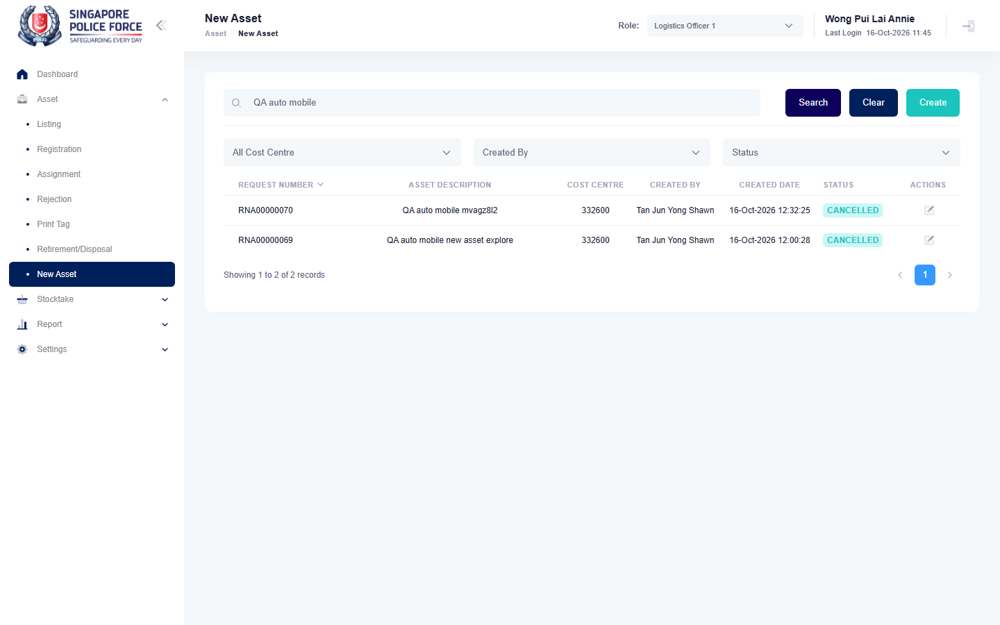

# Run report: mha-mobile / playwright / staging

| Field | Value |
|---|---|
| Result | **FAIL (1 failed)** |
| Run | 2026-10-16_1134_staging_playwright |
| Runner | playwright |
| Base URL | https://mhauatweb.southeastasia.cloudapp.azure.com/ |
| Started | 2026-10-16 11:34 |
| Duration | 11m 46s |

## Summary

| Total | Pass | Fail | Flaky | Blocked | Skipped |
|---:|---:|---:|---:|---:|---:|
| 5 | 4 | 1 | 0 | 0 | 0 |

## Results

| ID | Title | Status | Checks | Time | Notes | Evidence |
|---|---|---|---|---|---|---|
| MHM-008 | relocation made on the mobile app is approved and moves the asset on mha web | pass | 121/121 | 3m 34s | - | - |
| MHM-009 | relocate form pre-fills the asset's location remarks | pass | 70/72 | 2m 55s | BUG-002 | - |
| MHM-010 | new asset reported on the mobile app shows on mha web | fail | 3/3 | 11.3s | untriaged | [1](screenshots/MHM-010-a1-1.png) [2](traces/MHM-010-a1-3.zip) |
| MHM-011 | fave sighting made offline is uploaded after reconnecting and shows on mha web | pass | 83/83 | 1m 60s | - | - |
| MHM-012 | home tiles follow the active role | pass | 83/83 | 2m 57s | - | - |

## Failures and warnings

### MHM-010: new asset reported on the mobile app shows on mha web (fail)

- Failure type: untriaged
- Source: `projects/mha-mobile/tests/e2e/new-asset/new-asset.spec.ts`
- Error: ExpectError: Cannot read properties of undefined (reading 'map')

## Notes

Playwright project "mha-mobile". Full Playwright HTML report: reports/playwright-html/index.html, open with npm run report (overwritten by the next run).
