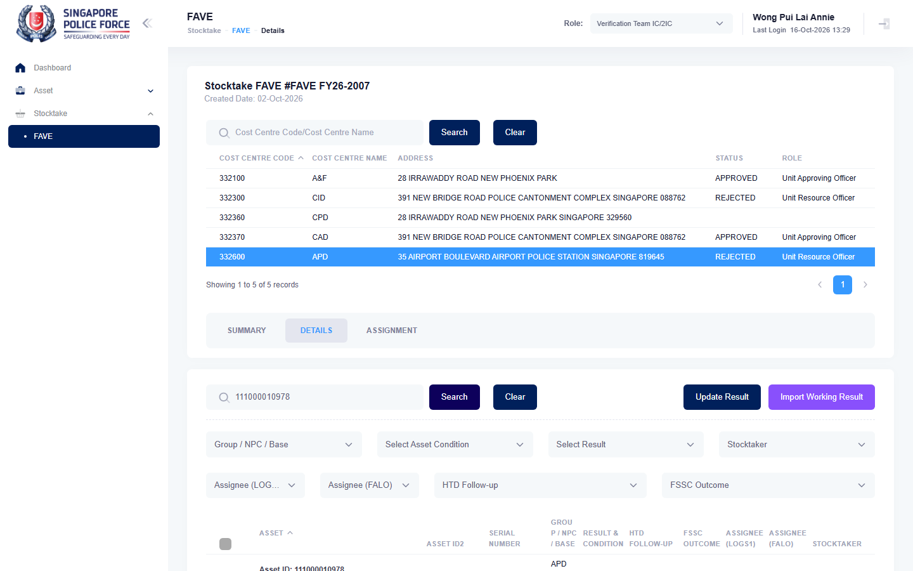

# Run report: mha-mobile / playwright / staging

| Field | Value |
|---|---|
| Result | **FAIL (1 failed)** |
| Run | 2026-10-16_1329_staging_playwright |
| Runner | playwright |
| Base URL | https://mhauatweb.southeastasia.cloudapp.azure.com/ |
| Started | 2026-10-16 13:29 |
| Duration | 2m 46s |

## Summary

| Total | Pass | Fail | Flaky | Blocked | Skipped |
|---:|---:|---:|---:|---:|---:|
| 1 | 0 | 1 | 0 | 0 | 0 |

## Results

| ID | Title | Status | Checks | Time | Notes | Evidence |
|---|---|---|---|---|---|---|
| MHM-018 | fave sighting at a wrong location on the mobile app raises a relocation for logs1 | fail | 68/70 | 2m 43s | untriaged | [1](screenshots/MHM-018-a1-1.png) [2](traces/MHM-018-a1-3.zip) |

## Failures and warnings

### MHM-018: fave sighting at a wrong location on the mobile app raises a relocation for logs1 (fail)

- Failure type: untriaged
- Source: `projects/mha-mobile/tests/e2e/stocktake/fave-outcomes.spec.ts`
- Failed: Step: 2. Sighted on, Correct Location off; new location: postal code 819645, Room Q903W; SAVE > CONFIRM (actual: `ExpectError: Expected element to have text "/^(Building Name)?$/", but no matching element was found`)
- Failed: Step: expect.not.toHaveText() (actual: `ExpectError: Expected element to have text "/^(Building Name)?$/", but no matching element was found`)
- Error: ExpectError: Expected element to have text "/^(Building Name)?$/", but no matching element was found

## Notes

Playwright project "mha-mobile". Full Playwright HTML report: reports/playwright-html/index.html, open with npm run report (overwritten by the next run).
