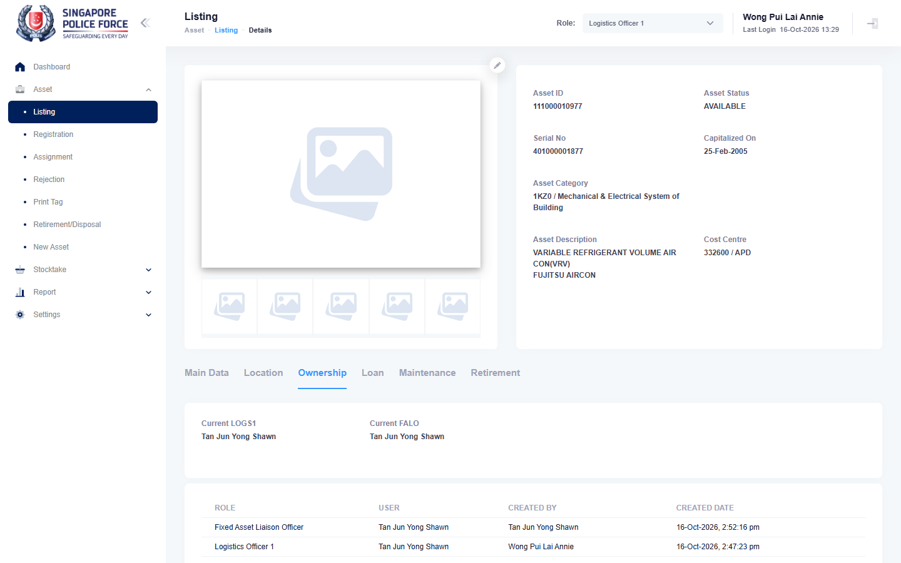

# Run report: mha-mobile / playwright / staging

| Field | Value |
|---|---|
| Result | **FAIL (1 failed)** |
| Run | 2026-10-16_1338_staging_playwright |
| Runner | playwright |
| Base URL | https://mhauatweb.southeastasia.cloudapp.azure.com/ |
| Started | 2026-10-16 13:38 |
| Duration | 21m 52s |

## Summary

| Total | Pass | Fail | Flaky | Blocked | Skipped |
|---:|---:|---:|---:|---:|---:|
| 6 | 5 | 1 | 0 | 0 | 0 |

## Results

| ID | Title | Status | Checks | Time | Notes | Evidence |
|---|---|---|---|---|---|---|
| MHM-014 | assignment to a falo made on the mobile app is auto-approved on mha web | pass | 105/105 | 4m 44s | - | - |
| MHM-015 | falo return made on the mobile app is approved by logs1 on mha web | fail | 101/102 | 5m 41s | untriaged | [1](screenshots/MHM-015-a1-1.png) [2](traces/MHM-015-a1-3.zip) |
| MHM-016 | recall made on the mobile app needs uro approval and clears the falo | pass | 102/102 | 4m 24s | - | - |
| MHM-017 | fave not sighted result submitted on the mobile app opens an investigation on mha web | pass | 84/84 | 2m 13s | - | - |
| MHM-018 | fave sighting at a wrong location on the mobile app raises a relocation for logs1 | pass | 110/110 | 3m 8s | - | - |
| MHM-019 | ad hoc stocktake assigned on mha web reaches the stocktaker's mobile app | pass | 46/48 | 1m 30s | BUG-003 | - |

## Failures and warnings

### MHM-015: falo return made on the mobile app is approved by logs1 on mha web (fail)

- Failure type: untriaged
- Source: `projects/mha-mobile/tests/e2e/assignment/assign.spec.ts`
- Failed: Step: 2-3. Phone: Fixed Asset Liaison Officer | 332600, Assign the asset to Logistics Officer 1 = TAN JUN YONG SHAWN (actual: `Error: The dropdown did not open`)
- Error: Error: The dropdown did not open

## Notes

Playwright project "mha-mobile". Full Playwright HTML report: reports/playwright-html/index.html, open with npm run report (overwritten by the next run).
